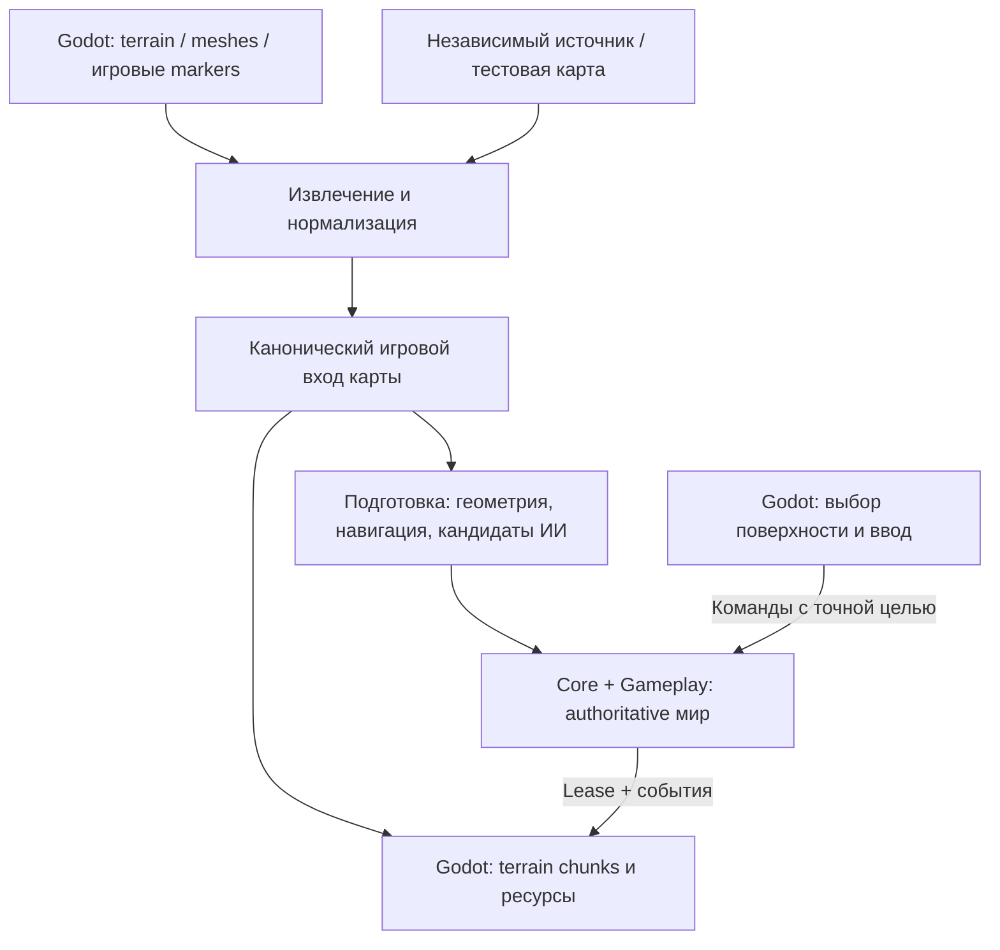

# 3D-карты: готовность OpenRTS и направление развития

**Дата:** 16 ноября 2026 года. **Статус:** исследование и проект, не принятое ADR. Код не менялся, новые игровые проверки и замеры не выполнялись. Основа — исходники OpenRTS `b6ffbf0551beeffaf2d2f30d6822e45ec982f86b`, существующие исследования Godot и компиляции карт; [метод, версии и доказательства](sources.md).

## Ответ

OpenRTS подходит как архитектурная основа RTS с трёхмерным изображением и сложным наземным рельефом. Уже имеются независимая симуляция, целочисленная высота, terrain-профили, физические размеры, кадры и часть пространственной баллистики. Переписывать ECS, команды, экономику и производство ради 3D не требуется.

Но полноценные 3D-карты ещё не поддержаны сквозным путём «редактор → карта → движение → бой → обзор → представление». Текущая наземная модель — одна дискретная поверхность на XY; содержимое карты M1 и визуальный terrain остаются плоскими. Авиация работает только над плоской опорой. Наличие `Elevation` не означает готовности всей геометрии.

**Рекомендуемое направление:** сохранить наземную 2.5D симуляцию и развить её до высотного поля с ограниченным набором дополнительных поверхностей и явных переходов. Godot использовать для редактирования, извлечения авторских данных и представления. В симуляцию поставлять независимую численную геометрию. Это позволяет получить холмы, рампы, обрывы, воду, позднее мосты и проходы под ними без обязательной объёмной сетки всего мира.

Generals, StarCraft 2 и Red Alert 3 здесь обозначают желаемый класс задач, а не спецификацию точного поведения этих игр. Полный паритет их механик не исследовался. Для Generals проверены отдельные исходники terrain/bridge/pathfinding; для остальных названия не используются как доказательство устройства движка.

## Что означает «3D» в этом плане

| Уровень | Возможности | Готовность / необходимая работа |
| --- | --- | --- |
| Визуальный 3D | Модели, освещение, камера, декоративные скалы над плоской игрой | Граница подходит; нужен новый renderer и управление камерой. Это ещё не игровой рельеф |
| Одна поверхность `H(X,Y)` | Холмы, плато, рампы, обрывы; берег и глубина при объявленной водной поверхности | Есть дискретная основа; нужны согласованные высота/геометрия, формат, движение, бой, обзор, стройка и авиация |
| Несколько поверхностей | Мост над дорогой, перекрытие, тоннель с проездом сверху; разные цели при одинаковых XY | Нет поддержки. Нужны идентичность поверхности, переходы, вертикальные объёмы и сквозная адресация |
| Произвольное объёмное пространство | Полёт в пещерах, стены/потолки как опора, произвольные вращаемые физические тела, деформация | Отдельное расширение требований; не условие RTS с обычным рельефом |

Высотное поле может описывать поверхность **внутри** клетки непрерывно; текущий `SurfaceSample` задаёт одну высоту всей клетки. Несколько плато на разных XY не требуют нескольких поверхностей. Два доступных места в одной XY требуют. Навес, который служит только препятствием для снарядов, может потребовать объём, но не дополнительную проходимую поверхность.

## Что фактически есть сейчас

Это результаты статического чтения кода и существующих проверок, не нового запуска.

| Подсистема | Реализовано | Чего это пока не даёт | Опора |
| --- | --- | --- | --- |
| Позиция / ECS / кадр | `WorldPosition(X,Y,Elevation)`, `SpatialState`, предыдущая позиция, высота в `EntityPose`; renderer интерполирует три координаты | Идентичности опоры, нормали поверхности и полной ориентации корпуса | S01, S02 |
| Terrain | Один `SurfaceSample(Elevation,Slope,Depth)` на cell; отдельный CellSize; частичные XY-препятствия | Непрерывной высоты, потолка, объёма скалы и перекрывающихся проходимых уровней | S03 |
| Наземное движение | `GroundPosition`/`TerrainStep` берут высоту текущей клетки; locomotor ограничивает slope/depth, геометрия — перепад | Плавной опоры на склон, различения рампы и ступени по одной величине Δheight, направленной uphill/downhill политики | S04 |
| Навигация | Weighted routes, exact world-space targets, проверка swept 2D body, отдельный planner; есть граница расчёта/следования | Surface-aware узлов/порталов; сменная регистрация `IGridPathfinder` обслуживает лишь невзвешенные поля, не весь новый поиск | S05 |
| Тела / занятость | Круг / axis-aligned box, относительное swept XY-движение, MotionIndex с несколькими ID на bin | Двух машин друг над другом, высоты машины и clearance под мостом. `BodyShape.HalfHeight` — половина размера по **Y земли**, не вертикаль | S06 |
| Бой | `SpatialTrajectory`: 3D шаг, travel limit, пересечение горизонтального/вертикального интервалов цели; воздушная дальность учитывает Z | Единой 3D-семантики боя. Ground-ground range/LoS остаются XY; наземная высота цели по умолчанию ±256, высота binary obstacle условно 512; splash упрощён | S07 |
| Обзор / сенсоры | F1, viewer filtering, события с аудиторией, knowledge/contacts | Закрытия обзора горой, этажности и высотного преимущества. F1-круги игнорируют terrain/высоту; специальные детекторы используют XY | S08 |
| Авиация | Hover/ForwardFlight, набор/снижение, стоянки, полоса, обслуживание, категории целей | Полёта над холмами: `ValidateFlightSurface` отклоняет неодинаковую Elevation до выдачи ID | S09 |
| Строительство | Footprint, CanStop/terrain/obstacles, четвертьобороты, проекты, освобождение площадки | Проверки перепада основания по всему footprint, фундамента, несущей поверхности, тоннельного габарита, water foundation | S10 |
| Карта / адаптер | Независимые M1/MapMatch; сцена Godot читает опубликованные данные | M1 не переносит surface/3D collision. `TerrainLayout.CreateGrid` передаёт только terrain, `TerrainView` ставит тайлы на Y=0; GroundPoint пересекает плоскость Y=0 | S11 |

N2-проверка уже содержит запрет slope/step/depth и движение по ступенчатому подъёму. Это подтверждает локальную основу, а не готовый workflow 3D-карт. Более поздние авиация, F1 и сенсоры учтены по текущему коду; ранние исследования, где они ещё отсутствуют, исторические.

## Какая архитектура подходит

Сохраняются текущие границы Core/Gameplay/Content. Геометрические примитивы и размещение могут расширяться в Core по реальному контракту; RTS-правила опоры, движения, боя и стройки остаются Gameplay, преобразование контента — Content, Godot API — адаптер/инструмент. Эта схема не предписывает новые сборки и универсальный geometry framework.

Нужно разделить три связанных представления:

1. **Опора и топология движения:** где агент может находиться и как перейти в другое место.
2. **Игровая геометрия:** что занимает объём, закрывает луч или перехватывает снаряд. Мост имеет настил, нижнюю грань и опоры; одно число высоты не описывает всё это.
3. **Визуальная геометрия:** детали, LOD, вода/волны, модель, анимация, свет. Она может быть богаче, но не должна противоречить границам игрового прохода.

Это разные данные одного согласованного источника. Проходимость не задаёт автоматически непрозрачность, а collision mesh для камеры не становится authoritative боевой геометрией. Уклон корпуса и подвеска могут быть косметическими; ограничения стрельбы по pitch требуют численного игрового контракта.

## Список доработок по потребителям

| Область | Нужная feature | Когда обязательна |
| --- | --- | --- |
| Пространственная модель | Каноническая высота/интерполяция, правила края/отверстий, единицы slope/step/depth, опора и точное положение | Первый настоящий рельеф |
| Навигация | Проверка непрерывного отрезка на опоре, рампы/обрывы, реальные габариты, согласованные cost и follower; позже поверхность в каждом узле и переходе | Рельеф; этажность отдельно |
| Локальное движение | Вертикальный extent и проверка совпадения во времени; ограничения борта/потолка и движение через переход | Перед открытием движения под мостом |
| Боевой мир | Высоты muzzle/aim/цели, terrain/prop/bridge volumes, дальность и первое попадание, splash/cover, pitch bounds при необходимости | Бой на рельефе; объёмы перекрытий до мостов |
| Обзор | Выбранная terrain-aware LoS policy, высота глаза/цели, разные правила оптики/радара, обновление и фильтрация | До обещания высотного преимущества/скрытия рельефом |
| Авиация | Упреждение горы, вертикальная достижимость, препятствия по траектории, площадки и заходы на высоте | Авиация на неплоской карте |
| Строительство | Допустимый перепад основания, фундамент/вода/опора, объём здания, выходы и подход строителя | Стройка на рельефе |
| Вода | Уровень воды отдельно от дна, глубина под телом, shore transitions и правила размещения; при нужде отдельный afloat locomotor | Суда / водные здания; один Depth недостаточен |
| Приказы и взаимодействия | Адресуемая поверхность в Move/waypoint/rally/placement; доступность погрузки, ремонта, захвата и снабжения между высотами | Перед этажностью; расстояние XY не доказывает доступ |
| ИИ | Профильные маршрутные расстояния, районы/проходы по поверхности, пригодность баз/площадок, береговые подходы, наблюдаемость | Вместе с MC3–MC6 и соответствующей игровой механикой |
| Карты / компиляция | Surface/volume/transition sections, версии и gameplay identity, диагностика неподдержанной геометрии, runtime changes и invalidation | До первого Godot → gameplay bake рельефа |
| Godot editor | Terrain source, семантические markers, gizmos опоры/объёма/уклонов/переходов, стабильные IDs, общий compile/run/export | Авторский пилот |
| Godot runtime | Рельефные чанки, 3D модели, picking поверхности, камера над terrain, ground-conforming overlays, 3D fog/occlusion | Видимый 3D-пилот |
| Совместимость и стоимость | Команды/hash/frame/events, bounded preparation, worker parity, отдельные CPU/GPU/memory измерения | Каждый этап, меняющий правила |

Вода, корабли и подводность не обязательны для сухопутного heightfield. Земля и дно могут быть одним базовым высотным полем; водная поверхность — отдельная опора для судна. Если нужна только декоративная вода над непроходимой зоной, достаточно её явно обозначить. Шейдерные волны не меняют authoritative высоту.

## Почему не переключить всё на Godot Navigation / Physics

Godot NavigationMesh представляет доступную поверхность для центра агента; размер учитывается при bake через отступ. Обновления коллайдеров и картинки сами по себе не обновляют этот маршрутный мир. NavigationObstacle может влиять на bake и avoidance; эти режимы не равны полной поддержке наших динамических footprint, CanStop, cost, групп и воспроизводимого расписания. [Документация navmesh](https://docs.godotengine.org/en/stable/tutorials/navigation/navigation_using_navigationmeshes.html), [NavigationObstacle3D](https://docs.godotengine.org/en/stable/classes/class_navigationobstacle3d.html).

Navmesh — допустимый будущий backend, если непрерывный полигональный рельеф даст измеренную пользу. Он всё равно требует профильных clearance, поверхностей, стоимостей, динамических обновлений и согласованного follower. Рекомендуется сначала проверить heightfield/patch graph с нынешней геометрией и MC4-иерархией. Не объединять смену backend с первой интеграцией редактора.

Перенос authoritative физики в Godot — альтернативная архитектура с пересмотром headless, owner thread, численных гарантий и порядка callbacks. Он может быть сознательным продуктовым выбором, но для этой цели исходники не дают оснований считать его необходимым. Godot raycasts подходят для выбора/диагностики и offline extraction; результаты боевого столкновения определяет симуляция.

## Как избежать повторной переделки

До стабилизации MC1/MC8 нужно согласовать понятия поверхности, объёма, перехода и цель с выбранной опорой. В первой поставке может быть только одна поверхность, а unsupported многослойность отклоняется. Не нужно сейчас добавлять пустые ECS-компоненты каждому юниту или реализовывать все будущие секции.

Нельзя заморозить внешний формат с обещанием «одна XY → одна цель навсегда», использовать `Elevation` одновременно как SurfaceId, привязать runtime ID к порядку Nodes или переносить footprint по всем слоям. Такие допущения создадут наиболее дорогую переделку. Версионируемое расширение старого API и явное разрешение legacy XY-команд на единственную поверхность сохраняют плоские сценарии.

Первый практический срез — небольшая карта с холмом, рампой, обрывом и местом для здания: Godot → независимый артефакт → одинаковый headless/Godot journal. Бой, обзор и авиацию добавлять к ней отдельными проверяемыми срезами. Мост с дорогой под ним нужен следующим обязательным экспериментом **до** закрепления формата многослойной карты и навигационного атласа.

Подробности: [контракты и алгоритмы](contracts.md) · [этапы, зависимости и проверки](plan.md) · [источники](sources.md).
