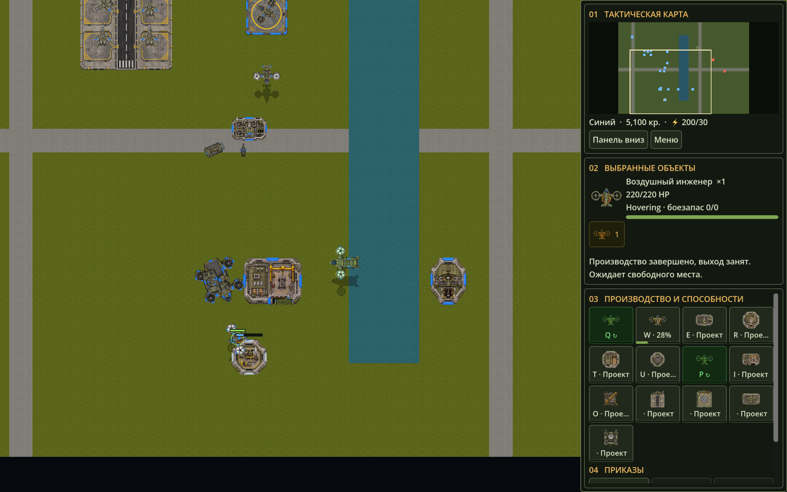

# Воздушные рабочие и тяжёлый транспорт

**Статус:** реализовано и проверено 16 ноября 2026. Связи: [авиация](../../decisions/032-aviation-and-target-categories.md), [стройка](../buildings-and-footprints/construction-workflow.md), [транспорт](../../decisions/027-registered-transport-and-construction.md).

## Контракт

- Hover-аппарат может быть строителем или перевозчиком снабжения. ForwardFlight сохраняет ограничение: эти действия требуют возможности зависать. Самолёт не становится пассажиром, источником ресурсов или аэробазой.
- Стройка, захват, поддержка апгрейда, ручной ремонт и снабжение Hover-аппаратом выполняются над центром цели на крейсерской высоте, с допуском 256 мировых единиц по X/Y. Подлёт и взлёт не начисляют работу. Наземный footprint и занятость не отправляют его к наземному периметру. Высокая авиация не мешает закладке фундамента. Производство по-прежнему требует свободной совместимой стоянки.
- `Builder.WorkInterval: 2` даёт вклад раз в два тика для стройки, захвата и поддержки апгрейда; обычное значение 1 сохраняет прежний темп. Фаза зависит от Tick/EntityId, не от порядка ECS. Пропущенный вклад захвата сохраняет активность стороны, поэтому не вызывает затухание. LowPower продолжает замедлять строительство независимо. Ремонт и перевозка ресурсов не замедляются этим параметром.
- `Presentation.WorkRoaming: true` включает визуальные перемещения по клеткам цели при Engaging Build/Capture/UpgradeSupport. Флаг выключен по умолчанию; false сохраняет неподвижное зависание. Ремонт не использует roaming. Визуал не меняет SpatialState, RNG, приказы, длительность работ или fingerprint.
- Снабженец использует прежний цикл Truck: общий запас шахты и очередь дока, собственный груз, кредит владельцу только при разгрузке. Не телепортируется между объектами и не загружает ресурс во время подлёта.
- Тяжёлый транспорт использует существующие 12 Slots: пехота стоит 1, техника 6. Допустимы 12 пехотинцев, 2 машины либо 1 машина и 6 пехотинцев. Переполнение отклоняется. Погрузка и выгрузка требуют посадки; занятые выходы удерживают пассажиров. Загруженный носитель не помещается внутрь другого носителя.

## Реализация и проверка

Симуляция хранит единственный устойчивый якорь рабочего над целью. Представление выбирает псевдослучайные клетки footprint по ID цели/инженера и временному сегменту, удерживает позу и плавно переносит её к следующей. Начальный и конечный переходы должны быть плавными, повреждение/приказы продолжают использовать реальную позицию. Если потребуются физические перелёты и уязвимость по точке отображения, это будет изменением игрового контракта, а не включением визуального флага.

`FlightState.WorkingTick` — производный маркер только текущего тика: он подавляет мягкое раздвигание во время работы, чтобы соседний рабочий не выталкивал аппарат с якоря. В следующем тике готовность вычисляется заново. Маркер не входит в хеш, как и временный `MovementRequested`; физическая позиция и фаза полёта остаются каноническими. Все показанные позиции, тени и выделение используют общий визуальный offset, без ссылки на ECS.

Проверки: пересечение непроходимой полосы; крупный фундамент под рабочим; половинный темп всех трёх работ и обычный ремонт; взлёт при совпадающих X/Y; воздух/земля и 1/4 workers; полный ресурсный цикл с сохранением общей суммы; загрузка смешанных размеров и выгрузка после посадки; повтор кадров и выключенный roaming не меняют мир. Спрайты и промпты: [манифест](../../assets/air-support-art.json).

Границы: плоская опорная поверхность авиации сохраняется. Мягкое раздвигание воздушных тел не даёт общей гарантии разрешения любых плотных заторов. Работа с уже имеющимися заменёнными Capture/Construction механиками проверяется отдельно от встроенного темпа.

## Результаты

- Сборки Debug и Release прошли без предупреждений и ошибок. Все **344 проверки OpenRTS и 20 DeclarativeContent** прошли. Девять новых проверок находятся в `AirSupportChecks`; в них есть сравнение 1/4 workers для строительства и полного рейса снабжения, сохранение суммы stock/cargo/credits, совместная стройка и отмена захвата до первого вклада. Последний случай также защищает от отрицательного затухающего счётчика.
- При ручном назначении Harvest прежнее намерение посадки/обслуживания отменяется. Отдельная проверка подтверждает возврат к загрузке над шахтой после команды Land.
- Headless и графический Godot 4.7.2 выполнили один журнал `--aviation` на **1200 тиках**: 23 сущности, хеш `B31EEC49739DBAAECE1E40CFA2E4584808C361D1C6D022F855A4BC9D040034B9`. Воздушный инженер строит, оборудует шахту и затем захватывает вышку; снабженец летает через воду, транспорт перевозит и выгружает два танка.
- `--verify-aviation` проверяет паузы/переносы при Build/Capture/UpgradeSupport, отсутствие roaming при ремонте и выключенном флаге, повторяемость позиции и разные соседние рабочие клетки. `--verify-skirmish` и `--verify-presentation` прошли, включая alpha всех PNG, ремонт и прежние 10000 спрайтовых поз. При проверке исправлена инициализация настроек радиусов вне terminal HUD; диагностический showcase больше не обращается к пустому массиву стилей.
- Пять golden traces обновлены из-за новых definitions/рецептов, ordinal-индексов и шестипоинтовых Passenger у БТР/танков. Визуальный WorkRoaming в gameplay fingerprint не входит. Отдельный профиль стоимости массовых воздушных рабочих не выполнялся.

Запуск: `./tools/dev.sh run --aviation`. Полигон интерактивен; конечный журнал проверяется `--verify-aviation`. Все три новых типа производятся на вертолётной площадке. В панели груза видны использованные поинты и стоимость каждого пассажира. Техническая подготовка PNG: `Godot --headless --path sandbox --script ../tools/prepare_air_support_art.gd`.

