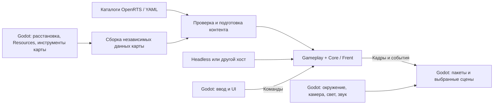

# Интеграция OpenRTS с редактором и runtime Godot

**Исследование:** 12 ноября 2026 года. **Уточнение направления:** 17 ноября 2026 года. Пользователь выбрал ближайший этап B, целевую модель C и дальнюю опцию частичного D. [Общий план](roadmap.md) и [подробный проект B](stage-b-design.md) описывают текущую работу; реализации ещё нет. Исходное сравнение ниже сохраняет контекст выбора.

Основная концепция — независимая OpenRTS-симуляция и гибридный runtime. Сначала Godot становится опциональным редактором с цепочкой «сцена → независимый документ → общий compiler → игровая карта». Затем развиваются управляемые семантические контракты с представлением. Позднее можно подменять отдельные игровые подсистемы внешними адаптерами, сохраняя независимые реализации основным режимом. Расширенная компиляция навигации/ИИ и игровой 3D terrain — отдельные эпики после C.

**Уточнение и реализация 18 ноября:** конечный B — дополнительный scene-map формат: игра открывает полноценную Godot-сцену карты вместе с её compiled проекцией для симуляции. YAML остаётся самостоятельным упрощённым форматом. Ранний A-подобный срез не заменяет эту цель. B0–B1 уже дают независимый [контракт и компилятор 047](../../decisions/047-map-compilation.md); B2 уже реализовал [authoring addon и извлечение 048](../../decisions/048-godot-map-authoring.md), запуск entry сцены остаётся B4.

Главный вывод: **тесная интеграция с редактором Godot совместима с независимой симуляцией**. Можно размещать юниты в сцене, видеть их спрайты и footprint, выбирать владельца и тип, редактировать характеристики через Inspector, рисовать рельеф и собирать карту для запуска без Godot. Для этого не требуется переносить игровой мир из Frent в SceneTree или заменять ECS.

Рекомендуемое направление — опциональные инструменты Godot для подготовки контента плюс существующая граница команд и кадров во время игры. Авторские узлы переводятся в проверенные данные до запуска симуляции. Массовые юниты остаются ECS-сущностями и отображаются пакетно; отдельные сцены можно использовать для окружения, камеры, звука, эффектов и немногих специальных объектов. Это вывод из текущей архитектуры и возможностей API, **не результат прототипирования производительности**.

## Содержание исследования

- [План B → C → частичный D](roadmap.md): выбранное направление, границы этапов и будущих эпиков.
- [Архитектура и реализация B0–B7](stage-b-design.md): optional addon, свойства, документы/артефакты, приоритеты и критерии готовности.
- [Переиспользование Network/replay](network-reuse.md): фактические APIs, необходимые дополнения и совместимость карты/журнала.
- [Что уже есть в OpenRTS и чего не хватает](current-boundary.md): проверенные исходники, загрузка карты, создание мира, кадры, характеристики и координаты.
- [Работа в редакторе Godot](authoring.md): расстановка, Inspector, источники данных, рельеф, компиляция карт, идентичность и обновление параметров.
- [Варианты runtime и ECS](runtime-and-ecs.md): тесная интеграция, гибрид, GECS, Godex, Stagehand/Flecs и сохранение Frent.
- [Пилоты и критерии выбора](experiments.md): что проверить перед реализацией и какие результаты могут изменить рекомендацию.
- [Источники, доказательства и ограничения](sources.md): локальные ревизии, проверенные внешние источники и матрица существенных выводов.

## Какую задачу решаем

Хотим удобнее создавать карты и игровые наборы: расставлять объекты мышью, менять свойства без правки C#, повторно использовать группы объектов, видеть ошибки размещения и пробовать карту из редактора. При этом желательно сохранить desktop C# runtime, существующие правила RTS, headless и возможность другого графического движка.

Под «сложной картой» здесь рассматриваются большие тайловые ландшафты, составные декорации, нейтральные и разрушаемые объекты, точки старта, группы юнитов, зоны и подготовленные сценарные данные. Произвольные многоуровневые поверхности, полноценная 3D-физика и готовая система миссий не появляются от подключения редактора: для них нужны отдельные механики симуляции.

## Независимые решения

| Решение | Варианты | Что действительно меняется |
| --- | --- | --- |
| Где автор редактирует карту | YAML, собственная панель Godot, обычная Godot-сцена | Удобство и зависимость инструментов от редактора |
| Где хранится первичный источник | Независимый документ или `.tscn`/`.tres` | Возможность пересобрать карту без Godot, стоимость синхронизации |
| Кто владеет состоянием матча | OpenRTS, Godot либо явно разделённые механики | Детерминизм, headless, переносимость и объём переделок |
| Как рисуются объекты | Пакеты, отдельные сцены, сочетание | Цена сцены и кадра, возможности анимации и эффектов |
| Где хранится ECS | Нынешний Frent или другая библиотека | Runtime и миграция данных; сам по себе выбор не даёт редактор карт |

Поэтому «адаптер» не означает бедный редактор, а «тесная интеграция» не обязательно означает Godot в Core.

## Четыре жизнеспособных направления

| Вариант | Что получает автор | Зависимость от Godot | Основная цена | Когда разумен |
| --- | --- | --- | --- | --- |
| **A. Независимые данные, Godot как редактор** | Палитра типов, рисование и расстановка, Inspector поверх документа, предпросмотр | Для удобного редактирования; runtime и исходная карта независимы | Собственный редактируемый документ, сохранение, undo и связь с YAML | Нужны сторонние редакторы, моддинг или подготовка карт без Godot |
| **B. Godot-сцены/Resources → независимая сборка карты** | Обычные transform tools, экземпляры сцен, Inspector, композиция окружения | Для подготовки и пересборки; готовый игровой вход независим | Компилятор сцены, версия артефакта, диагностика и проверка актуальности | Главный рабочий инструмент — Godot, но симуляция должна оставаться переносимой |
| **C. Гибрид во время игры** | В дополнение к A/B — сцены специальных объектов, Godot-анимации и эффекты, live inspection | В выбранных системах представления/хоста | Явное владение данными, адресация EntityId, стоимость связи и lifecycle | Нужны возможности Godot поверх массового RTS-мира |
| **D. Godot владеет игровым миром** | Нативные Nodes, signals, Physics/Navigation, привычный godot-first workflow | Игровое исполнение зависит от Godot; сервер может быть Godot headless | Пересмотр наших навигации, времени, физики, ECS, тестов и переноса | Продукт сознательно выбирает Godot-only и его механики важнее нынешних гарантий |

A и B — альтернативы для первичного источника конкретного документа; выбран B. C дополняет его. Исходный D в таблице описывает полную Godot-first альтернативу; текущий план выбирает только подмену отдельных механик и не требует перехода всего мира на Godot.

**Выбран B с YAML-каталогами типов.** Размещения и оформление карты редактируются в Godot; независимый compiler совместно с M1 importer готовит игровой вход. Ограниченные map-local variants и initial state проектируются отдельно от общих типов. Обязательное повторное сравнение A/B больше не является шагом реализации; A остаётся резервом при существенной проблеме авторского workflow.

## Предлагаемая граница

Это логические обязанности, не предложение заранее создавать новые сборки и универсальные интерфейсы. Существующий `src/OpenRTS.Godot` уже опционален относительно Core/Gameplay. Его отдельная поставка и editor plugin оправданы первым работающим потребителем, а не необходимостью переписать всё сразу.

## Что получим и где останется работа

Для расстановки и свойств Godot предоставляет `[Export]`, `[GlobalClass]`, `[Tool]`, расширение Inspector и gizmos. Их достаточно, чтобы построить специализированную авторскую оболочку над нашими данными. Они не сериализуют произвольный immutable .NET definition автоматически: нужны редакторские поля и явное преобразование. [C# exports](https://docs.godotengine.org/en/stable/tutorials/scripting/c_sharp/c_sharp_exports.html), [global classes](https://docs.godotengine.org/en/stable/tutorials/scripting/c_sharp/c_sharp_global_classes.html), [editor plugins](https://docs.godotengine.org/en/stable/classes/class_editorplugin.html).

Самая существенная разработка находится на границе данных: выбрать один источник истины, сохранить идентичность объектов и порядок размещения, сделать проверку геометрии, связать диагностику с исходным объектом и исключить устаревшую сборку карты. Для сложного рельефа дополнительно требуется явный перевод в `NavigationGrid`, surface samples и препятствия.

ECS-плагины полезны как примеры авторского workflow и диагностики. GECS опирается на Nodes/Resources; Godex — модуль сборки движка с давно не обновлявшейся основной веткой; Stagehand — ранняя C++/Flecs GDExtension с дополнительным ограничением лицензии. Оснований менять работающий Frent ради Inspector не найдено. [Подробное сравнение и точные ревизии](runtime-and-ecs.md).

B0–B3 выполнены в описанных границах: [terrain/Models/gizmos 049](../../decisions/049-godot-terrain-models-preview.md). Следующий шаг — B4: scene-map bundle, entry loader и весь путь поставки. [Действующие этапы и проверки](stage-b-design.md). [Прежние эксперименты](experiments.md) сохраняются как исследовательские альтернативы, не как конкурирующий текущий план.
