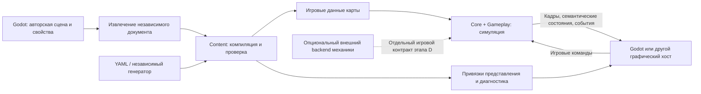
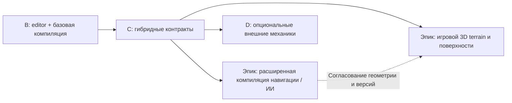

# План интеграции Godot с OpenRTS

**Обновлён:** 18 ноября 2026 года. **Статус:** направление B → C → опциональный частичный D задано пользователем; B0–B5 реализованы. Работают 2D-авторинг и рельеф v3 с compiled playtest. Ближайшие доработки B уточнены по аудиту, B6 выделен в самостоятельный этап. Основа первоначального чтения — OpenRTS `afb7aef5a46bb937b39c8b63269e935c2a5b91da`, реализации B0–B1 — `92ae9cab4028e5f6b3f120a0c479adefba4dc3e5` и рабочие изменения.

Ближайший результат — опциональный Godot editor plugin, которым можно собрать карту, настроить размещённые объекты и получить независимый игровой артефакт. Основная целевая модель — гибрид: OpenRTS владеет симуляцией, Godot предоставляет богатое представление и игровые интерфейсы. Позднее отдельные игровые подсистемы смогут заменяться адаптерами к Godot или другому исполнителю.

**Уточнение 18 ноября:** B — дополнительный продвинутый формат карты игры: полноценная Godot-сцена и извлечённые из неё данные/совместимые подготовленные секции симуляции. Выбор такой карты запускает соответствующую сцену, сохраняя её обычные scripts, группы, камеры и ролики; independent data передаются OpenRTS. Упрощённый YAML остаётся отдельным форматом. Короткий A-подобный результат допустим как ранний срез B, но не заменяет его конечную scene-based модель. B0–B1 реализованы по [контракту 047](../../decisions/047-map-compilation.md); [B2 addon и scene extraction 048](../../decisions/048-godot-map-authoring.md) реализованы; [B3 terrain/Models preview 049](../../decisions/049-godot-terrain-models-preview.md) также реализован; [B4 scene-map bundle](../../decisions/050-godot-scene-map-bundle.md) реализует публикацию и запуск из редактора и меню.

[Ближайшие приоритеты по итогам аудита](authoring-audit.md) · [Проект этапа B](stage-b-design.md) · [Отдельный этап B6](network-reuse.md) · [Исходное исследование](README.md) · [Компиляция карт](../map-compilation/README.md) · [3D terrain](../3d-terrain/README.md).

## Общая модель и границы

Различаются четыре вида данных: авторская сцена; независимый документ для компилятора; скомпилированная карта; состояние уже идущего матча. Runtime snapshot и replay относятся к последнему виду, не заменяют первые три. Слоты/старты принадлежат карте, назначение игроков и стартового набора — настройке матча. Один файл может объединять несколько поставляемых секций, но обязанности сохраняются.

Godot-сцена может содержать реалистичный свет, визуальную погоду, частицы с физикой, декоративные анимации, брифинг и видеовставки. Они не входят в игровой hash, если не меняют решения симуляции. Если дождь меняет скорость, огонь наносит урон, а вставка вызывает подкрепление, соответствующий факт/команда принадлежит игре и воспроизводится обычным путём. Форму капель и пламени продолжает выбирать Godot.

Не требуется ограничивать число декоративных узлов правилом «один Node запрещён всегда». Ограничение относится к массовому runtime и его измеренной цене. Авторские markers, дорогие единичные эффекты и камеры могут быть узлами. Для тысяч юнитов сохраняется пакетное представление, для editor preview проверяются отдельные стратегии.

OpenRTS предоставляет основу для сборки игр. Каждая игра подбирает игровые механики, один или несколько нужных ей способов представления и совместимые карты. Классический 2D и нативная изометрия используют Canvas. 2.5D-презентация может использовать 3D-редактор и фиксированный ортографический вид. Пространственные игры могут использовать полноценную 3D-сцену. `sandbox` и `sandbox3d` служат примерами таких сборок. [Исследование типов симуляции и представления](../simulation-modes/README.md).

## Три этапа

| Этап | Назначение | Проверяемый результат | Что не требуется для завершения |
| --- | --- | --- | --- |
| **B. Редактор и базовая компиляция** | Godot-сцена → независимый документ → проверенная карта → игра | Расстановка, свойства, базовый terrain, диагностика, локальный запуск и проверка загрузки без editor plugin | B6, иерархия маршрутов, атлас ИИ, многоопорный terrain, общий scripting |
| **C. Гибрид во время игры** | Устойчивые связи между симуляцией и богатым представлением | Игровой семантический факт управляет эффектом/сценой, корректно переживает spawn/remove, replay seek, POV и restart | Подмена authoritative навигации/физики, новый ECS, произвольный RPC в движок |
| **D. Сменные внешние механики** | Подмена одной выбранной игровой подсистемы | Одна реальная альтернативная реализация с явными правилами, версиями и условиями replay/network | Перенос всего мира в Godot, обязательность Godot для стандартной симуляции |

Простая загрузка визуального окружения и нынешние Models работают уже в B. В C расширяется управляемая связь во время игры: новые потребители, lifecycle, восстановление и game-specific контракты. Косметику не нужно искусственно откладывать до C.

## Этап B — карта как продукт редактора

### Объём

Опциональный C# plugin в Godot .NET, маркеры размещений и стартов, Inspector, контуры body/footprint и terrain. Доступны плоская сетка и одна поверхность v3, которую сейчас можно редактировать через нативный 2D TileSet. Определения типов по умолчанию берутся из действующих YAML-каталогов. Карта может объявлять ограниченные локальные варианты типа; их компиляция отделена от начального состояния конкретного экземпляра.

Обычные Nodes/Resources и сцены Godot — авторский источник и полноценная игровая сцена нового формата. Извлечение выдаёт независимый документ, общий compiler в Content проверяет и выпускает игровую проекцию карты. В 3D bundle Godot-хост открывает связанную сцену, а симуляция использует проекцию. Нативный 2D сейчас имеет путь compiled playtest, в котором sandbox строит отображение из данных карты. Полная 2D entry-сцена запланирована с Canvas-хостом в C. Headless использует игровую часть обоих форматов. Наличие Godot нужно для её исполнения и повторного извлечения изменённой `.tscn`, но не для самостоятельной симуляции из готовых данных.

Результат подключается к локальному sandbox и headless через общую фабрику начального мира. Регистрация в конфигурации игры учитывает различие skirmish и fixture. Точный выбор артефакта для сети и повторов относится к B6. Редактор не создаёт сущности непосредственно из `_Ready` каждого marker и не вводит отдельную версию RTS-правил.

### Связь с компиляцией карт

B реализует минимальную независимую основу **MC1** и authoring-ветку **MC8** из [плана компиляции](../map-compilation/plan.md). Это одна совместная работа, не два компилятора. В B не входят MC2–MC7: предварительные навигационные структуры, иерархия, динамические секторные обновления, площадки/районы и стратегия ИИ. Базовые размеры и времена загрузки фиксируются для диагностики, но исследование алгоритмов ускорения не является зависимостью редактора.

Скомпилированный вход B самодостаточен как численная карта и references на явно устанавливаемый игровой контент. Будущая ускоряющая секция будет строиться из него или поставляться с ним; её отсутствие не должно незаметно переключать правила. Расширение контейнера версионируется, но пустые секции и plugin registry всех будущих механик не создаются.

### Что делать дальше

1. **P0, выполнен.** 2D-шаблоны, типы и владельцы, маркеры с ID/order и undo, диагностика узла или клетки. TileMapLayer редактируется штатными средствами Godot.
2. **P0, выполнен.** Локальный playtest проверяет выбранные старты и стартовый набор перед запуском. Редактор и CLI используют общую сборку и сравнивают отчёт Godot с независимой симуляцией из того же артефакта. Проверяются 2D compiled map и 3D bundle. [Команды и форматы](../../decisions/050-godot-scene-map-bundle.md#сборка-и-проверка).
3. **P1, выполнен.** Реализованы 2D-группы и предпросмотр Models, тел, footprints и стартовых наборов, независимые визуальные слои и диагностика стыков рельефа. Док управляет остановкой и перезапуском playtest и показывает диагностику процесса. Чистая поставка 2D compiled map и 3D bundle проверена через PCK с отключённым addon. [Аудит](authoring-audit.md).
4. **B7 и дополнительные импортеры.** Замеры масштаба и проверка внешней игры по потребности. YAML → сцена и v3 авторинг в 3D viewport проходят отдельные пилоты. [Проект первого этапа](stage-b-design.md).

### Завершение

Плоская карта с живой 3D-сценой и рельефная карта с нативным 2D-авторингом проходят подготовку, сохранение, компиляцию, проверку конкретного матча и локальный запуск. Тот же compiled документ загружается в headless. До завершения B также проверяются предусмотренные P1 операции и поставка для выбранных профилей. Старые M1 и B5 сохраняют результаты. Изменение только оформления сохраняет игровой digest. Ошибка подготовки не запускает старую карту под видом новой. C может опираться на стабильный локальный путь, а B7 и B6 имеют собственную приёмку.

## B6 — отдельный этап Network и replay

**Выполнено.** 2D compiled map, 3D bundle и M1 доступны через существующий сетевой запуск, а параметры B6 связывают матч и повтор с игровой версией карты, стартового набора и правил. Локальный playtest записывается из редактора, а журналы воспроизводятся в Godot и headless. [Контракт B6](../../decisions/052-map-match-replays.md) · [Проверки](../../verification/052-map-match-replays.md).

## Этап C — семантические контракты и богатое представление

### Основа Models

Действующая граница уже передаёт направления, playback и состояния; `UnitCatalog.Presentations` связывает тип с Model, а `ModelCatalog` и Godot-ресурсы принадлежат представлению. Движок сообщает «объект в состоянии burning», а адаптер может показать sprite flame, GPU particles, свет и звук. Конкретный ресурс или качество эффекта не становятся игровым определением. [Presentation](../../decisions/007-presentation.md), [ModelCatalog](../../../src/OpenRTS.Content/Catalogs/ModelCatalog.cs).

По той же дисциплине добавляются только нужные игре контракты: постоянное состояние окружения, запрос воспроизведения эффекта/брифинга, камера или привязка специального view к EntityId. Это не заранее обязательные новые каталоги. Каждый появляется вместе с конкретным потребителем и минимальной проверкой.

Для игры с нативным 2D представлением один из потребителей C — полноценная Canvas entry-сцена карты. Пилот проверяет, что её собственные камера, тайловые слои и анимации работают вместе с опубликованными позами и событиями симуляции. 3D-игре достаточно её существующего scene-map пути. [Приоритеты профилей](authoring-audit.md).

### Выбор формы взаимодействия

| Нужда игры | Подходящий контракт | Условие |
| --- | --- | --- |
| Длительный пожар, дождь, состояние двери | Опубликованное семантическое состояние | Новый view и seek восстанавливают его без истории всех событий |
| Взрыв, звук выстрела, разовый cue | Событие с tick/identity и областью наблюдения | Пропуск render frame не теряет нужное событие; seek не переигрывает всю историю |
| Брифинг и локальная камера | Запрос/данные в host presentation | Завершение ролика само по себе не меняет игровое состояние |
| Выбор игрока в диалоге | Обычный проверяемый игровой intent | Значимый результат записан в журнал; local callback не меняет мир напрямую |
| Расчёт игрового результата внешним алгоритмом | Типизированная входная/выходная операция | Это этап D, если результат влияет на authoritative механику |

Инверсия зависимостей допустима: контракт определяется потребностью Gameplay/игры, реализация — в Godot-адаптере. Но вызов не даёт симуляции доступ к SceneTree с owner thread. Связь через очередь/публикацию отделяет потоки; синхронные функции уместны только при явно безопасном численном контракте. Универсальный `Call(string, object[])` не заменяет такую границу.

### Подэтапы C

1. **C1 — bindings и lifecycle.** Связать специальные views с EntityId и авторскими якорями, определить создание, потерю наблюдения, удаление, смену типа, carrier и restart. Начать с одного объекта: здание с постоянным пожаром и разовым взрывом.
2. **C2 — устойчивое состояние и события.** Уточнить authoritative семантику, аудиторию, start tick, длительность и косметический RNG. Проверить один cue окружения или брифинга без влияния на игровой hash.
3. **C3 — восстановление представления и диагностика.** Общий reset/generation contract для нового кадра, POV и восстановления; read-only inspection выбранного объекта, ограничения объёма и lifetime leases. Для проверки подходят существующий журнал или тестовая смена поколения. Разрешение карты для нового реплея относится к B6. Авторская обратная запись runtime-позиций требует отдельной явной команды.
4. **C4 — проверка независимости.** Тот же журнал работает в презентации игры и headless. Общий контракт при необходимости проверяется вторым потребителем на тестовом сценарии. Число/детали частиц, камера, качество света и FPS не меняют результат. Проверить стоимость смешанного массового и сценового представления.

Для игрового открытия ворот или подкрепления cue сначала возникает из состояния/команды симуляции. Если важный шаг должен ждать решение зрителя или игрока, фиксируется игровая policy и согласованная команда, а не момент завершения локальной Godot-анимации. Presentation-only footage может использовать реальное время; игровое расписание остаётся в тиках.

### Завершение

Минимум один полностью проверенный пример state + one-shot event, один scene view и один host cue работают при пропущенных кадрах, pause/step, смене поколения, POV и повторном запуске. Для совместимого журнала дополнительно проверяется seek вперёд/назад. Косметика соблюдает границы наблюдения. Desktop нагрузка и lifecycle проверяются отдельно по измеренному baseline.

Сборка игровых систем развивается по [плану модульности](../mechanic-modularity/composition.md). API этапа C использует текущую композицию мира. Новая сборка Simulation, полноценный DI и поддержка нескольких презентаций внутри одной игры имеют собственные критерии и не требуются для C.

## Этап D — опциональные реализации отдельных механик

Это **частичный D**, не переход всего OpenRTS на Godot-first runtime. Стандартная сборка по-прежнему использует независимые реализации. Подключение внешнего backend явно выбирает игра; отсутствие библиотеки не вызывает молчаливой смены правил.

Действующие `GameplayRegistration<T>` уже задают ID/version и фабрику мира для нескольких механик. `IGridPathfinder` заменяет лишь невзвешенные поля индивидуальных маршрутов, а не всю навигацию. Его нельзя объявлять готовой обёрткой NavigationServer. [GameplayMechanics](../../../src/OpenRTS.Gameplay/Simulation/GameplayMechanics.cs), [grid contract](../../../src/OpenRTS.Core/Navigation/IGridPathfinder.cs).

Подэтапы:

1. **D1 — реальный потребитель и граница.** Выбрать одну подсистему, которую выгодно делегировать. Определить inputs, результаты, ошибки, cancellation, owner thread, согласование с tick и стоимость перехода. Не вводить интерфейсы для всех подсистем сразу.
2. **D2 — адаптер и проверочный backend.** Описать соответствие численных данных, геометрии и версий; команды/итоговые результаты не зависят от порядка завершения callbacks. Стандартная реализация остаётся способом сравнения, но одинаковый путь двух разных алгоритмов не обещается.
3. **D3 — playback, snapshots и Network.** Задать capability режима: воспроизводимый расчёт у каждого peer либо отдельный согласованный режим доставки результатов. Невоспроизводимый внешний backend нельзя автоматически включить в существующий клиентский lockstep. Не готовый пока NET8/NET9 не считается решением этой проблемы.
4. **D4 — поставка и ограничения.** Backend ID/version и значимые настройки входят в identity; stateful реализация имеет schema восстановления или явно не поддерживает snapshot. Отсутствующий Godot backend даёт отказ с объяснением. Godot headless для этого режима — допустимый хост, но не независимый .NET runtime.

Для заранее записанного журнала может оказаться достаточно записывать authoritative результаты отдельных внешних операций. Для живого peer lockstep такое расширение требует отдельного протокола и его проверки; replay сам по себе не делает произвольные callbacks детерминированными. Решение принимается для выбранной механики, не общим обещанием «внешнее всегда можно воспроизвести».

## Отдельные эпики после C

По поручению пользователя реализация расширенной компиляции и полноценного игрового 3D не включается в B/C и может начаться **после C**. Эти эпики могут развиваться отдельно от D; Godot Navigation не является обязательным результатом 3D-эпика. В рамках B учитываются лишь границы их совместимости.

| Будущий эпик | Основа | Что предусмотреть сейчас |
| --- | --- | --- |
| Расширенная компиляция | [MC2–MC7/MC9](../map-compilation/plan.md): статическая подготовка, иерархия/инвалидация, возможности ИИ, запросы других систем | Достаточный независимый вход, версии и gameplay identity, derived data отдельно от правил; не фиксировать прогретый runtime cache как карту |
| Игровой 3D terrain | [T0–T9](../3d-terrain/plan.md): heightfield, поверхности/переходы, бой/обзор/авиация/стройка | v3 хранит одну поверхность с ограниченными рампами. Несколько опор и объёмы потребуют новых семантических данных и правил взаимодействия |

Уточнение к старым исследованиям: прежнее «сначала MC0–MC3» не блокирует B. Для нынешней цели приоритет — минимальная MC1 + MC8; оптимизации отложены. Аналогично ранний T0 означает учёт эволюции формата, а не необходимость реализовать высотную геометрию до плоского editor plugin.

## Постоянные требования всех этапов

- Core/Gameplay не получают Godot-объекты; Content не зависит от Network. Runtime views и авторские markers не становятся вторым владельцем ECS state.
- Hash/identity описывают значимые игровые данные и версии, а не NodePath, порядок Dictionary, native handles, абсолютные пути или байты косметической сцены.
- ID, композиция footprints, семантика start sets и воспроизведение не меняются из-за порядка Nodes. Формат не сортирует семантически упорядоченный список «для канонизации».
- Error/cancel не публикуют частичный мир/артефакт. Все UI-состояния отличают подготовку, ошибку, устаревшую версию и готовый результат.
- Уже реализованные runtime snapshots и реплеи используются в своём назначении. Условия восстановления внешней AI policy и будущего backend не расширяются одним появлением editor plugin.

Этапы не имеют календарных обещаний. Переход определяется проверяемым результатом, а точный публичный API закрепляется в соответствующем ADR при реализации.
