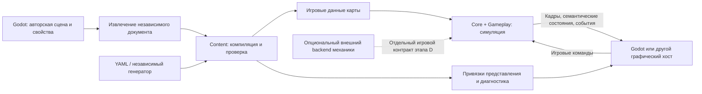
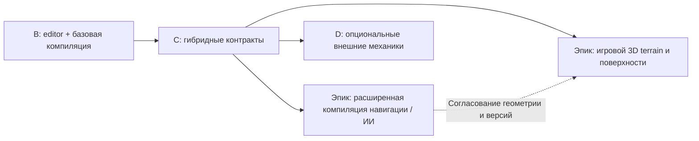

# План интеграции Godot с OpenRTS

**Обновлён:** 18 ноября 2026 года. **Статус:** направление B → C → опциональный частичный D задано пользователем; B0–B4 реализованы, остальные срезы проектируются. Основа первоначального чтения — OpenRTS `afb7aef5a46bb937b39c8b63269e935c2a5b91da`, реализации B0–B1 — `92ae9cab4028e5f6b3f120a0c479adefba4dc3e5` и рабочие изменения.

Ближайший результат — опциональный Godot editor plugin, которым можно собрать карту, настроить размещённые объекты и получить независимый игровой артефакт. Основная целевая модель — гибрид: OpenRTS владеет симуляцией, Godot предоставляет богатое представление и игровые интерфейсы. Позднее отдельные игровые подсистемы смогут заменяться адаптерами к Godot или другому исполнителю.

**Уточнение 18 ноября:** B — дополнительный продвинутый формат карты игры: полноценная Godot-сцена и извлечённые из неё данные/совместимые подготовленные секции симуляции. Выбор такой карты запускает соответствующую сцену, сохраняя её обычные scripts, группы, камеры и ролики; independent data передаются OpenRTS. Упрощённый YAML остаётся отдельным форматом. Короткий A-подобный результат допустим как ранний срез B, но не заменяет его конечную scene-based модель. B0–B1 реализованы по [контракту 047](../../decisions/047-map-compilation.md); [B2 addon и scene extraction 048](../../decisions/048-godot-map-authoring.md) реализованы; [B3 terrain/Models preview 049](../../decisions/049-godot-terrain-models-preview.md) также реализован; [B4 scene-map bundle](../../decisions/050-godot-scene-map-bundle.md) реализует публикацию и запуск из редактора и меню.

[Проект этапа B](stage-b-design.md) · [Переиспользование Network и replay](network-reuse.md) · [Исходное исследование](README.md) · [Компиляция карт](../map-compilation/README.md) · [3D terrain](../3d-terrain/README.md).

## Общая модель и границы

Различаются четыре вида данных: авторская сцена; независимый документ для компилятора; скомпилированная карта; состояние уже идущего матча. Runtime snapshot и replay относятся к последнему виду, не заменяют первые три. Слоты/старты принадлежат карте, назначение игроков и стартового набора — настройке матча. Один файл может объединять несколько поставляемых секций, но обязанности сохраняются.

Godot-сцена может содержать реалистичный свет, визуальную погоду, частицы с физикой, декоративные анимации, брифинг и видеовставки. Они не входят в игровой hash, если не меняют решения симуляции. Если дождь меняет скорость, огонь наносит урон, а вставка вызывает подкрепление, соответствующий факт/команда принадлежит игре и воспроизводится обычным путём. Форму капель и пламени продолжает выбирать Godot.

Не требуется ограничивать число декоративных узлов правилом «один Node запрещён всегда». Ограничение относится к массовому runtime и его измеренной цене. Авторские markers, дорогие единичные эффекты и камеры могут быть узлами. Для тысяч юнитов сохраняется пакетное представление, для editor preview проверяются отдельные стратегии.

## Три этапа

| Этап | Назначение | Проверяемый результат | Что не требуется для завершения |
| --- | --- | --- | --- |
| **B. Редактор и базовая компиляция** | Godot-сцена → независимый документ → проверенная карта → игра | Расстановка, свойства, terrain текущей модели, диагностика, запуск и повтор той же карты без editor plugin | Иерархия маршрутов, атлас ИИ, рельефные игровые поверхности, общий scripting |
| **C. Гибрид во время игры** | Устойчивые связи между симуляцией и богатым представлением | Игровой семантический факт управляет эффектом/сценой, корректно переживает spawn/remove, replay seek, POV и restart | Подмена authoritative навигации/физики, новый ECS, произвольный RPC в движок |
| **D. Сменные внешние механики** | Подмена одной выбранной игровой подсистемы | Одна реальная альтернативная реализация с явными правилами, версиями и условиями replay/network | Перенос всего мира в Godot, обязательность Godot для стандартной симуляции |

Простая загрузка визуального окружения и нынешние Models работают уже в B. В C расширяется управляемая связь во время игры: новые потребители, lifecycle, восстановление и game-specific контракты. Косметику не нужно искусственно откладывать до C.

## Этап B — карта как продукт редактора

### Объём

Опциональный C# plugin в Godot .NET, авторские markers размещений и стартов, Inspector, контуры body/footprint и палитра текущего плоского terrain. Определения типов по умолчанию берутся из действующих YAML-каталогов. Карта может объявлять ограниченные локальные варианты типа; их компиляция отделена от начального состояния конкретного экземпляра.

Обычные Nodes/Resources и сцены Godot — авторский источник и полноценная игровая сцена нового формата. Извлечение выдаёт независимый документ, общий compiler в Content проверяет и выпускает игровую проекцию карты. Godot-хост открывает связанную сцену, а симуляция использует проекцию; headless без Godot исполняет только игровую часть. Сцена не сводится к отдельной ветке декоративных картинок. Наличие Godot нужно для её исполнения и повторного извлечения изменённой `.tscn`, но не для самостоятельной симуляции из готовых данных.

Результат должен подключаться к выбору карт, headless, существующему offline host и Network/replay через одну фабрику начального мира. Редактор не создаёт сущности непосредственно из `_Ready` каждого marker и не вводит отдельную версию RTS-правил.

### Связь с компиляцией карт

B реализует минимальную независимую основу **MC1** и authoring-ветку **MC8** из [плана компиляции](../map-compilation/plan.md). Это одна совместная работа, не два компилятора. В B не входят MC2–MC7: предварительные навигационные структуры, иерархия, динамические секторные обновления, площадки/районы и стратегия ИИ. Базовые размеры и времена загрузки фиксируются для диагностики, но исследование алгоритмов ускорения не является зависимостью редактора.

Скомпилированный вход B самодостаточен как численная карта и references на явно устанавливаемый игровой контент. Будущая ускоряющая секция будет строиться из него или поставляться с ним; её отсутствие не должно незаметно переключать правила. Расширение контейнера версионируется, но пустые секции и plugin registry всех будущих механик не создаются.

### Завершение

Одна карта успешно проходит создание, редактирование, undo, сохранение/повторное открытие, компиляцию, регистрацию в игре, headless/Godot и replay с тем же игровым состоянием. Старый M1 продолжает загружаться. Изменение только света/материала не меняет gameplay identity; изменение расстановки или характеристики — меняет. Отказ подготовки не запускает старую карту под видом новой.

Приоритеты B0–B7 и точные сценарии приведены в [проекте первого этапа](stage-b-design.md).

## Этап C — семантические контракты и богатое представление

### Основа Models

Действующая граница уже передаёт направления, playback и состояния; `UnitCatalog.Presentations` связывает тип с Model, а `ModelCatalog` и Godot-ресурсы принадлежат представлению. Движок сообщает «объект в состоянии burning», а адаптер может показать sprite flame, GPU particles, свет и звук. Конкретный ресурс или качество эффекта не становятся игровым определением. [Presentation](../../decisions/007-presentation.md), [ModelCatalog](../../../src/OpenRTS.Content/Catalogs/ModelCatalog.cs).

По той же дисциплине добавляются только нужные игре контракты: постоянное состояние окружения, запрос воспроизведения эффекта/брифинга, камера или привязка специального view к EntityId. Это не заранее обязательные новые каталоги. Каждый появляется вместе с конкретным потребителем и минимальной проверкой.

### Выбор формы взаимодействия

| Нужда игры | Подходящий контракт | Условие |
| --- | --- | --- |
| Длительный пожар, дождь, состояние двери | Опубликованное семантическое состояние | Новый view и seek восстанавливают его без истории всех событий |
| Взрыв, звук выстрела, разовый cue | Событие с tick/identity и областью наблюдения | Пропуск render frame не теряет нужное событие; seek не переигрывает всю историю |
| Брифинг и локальная камера | Запрос/данные в host presentation | Завершение ролика само по себе не меняет игровое состояние |
| Выбор игрока в диалоге | Обычный проверяемый игровой intent | Значимый результат записан в журнал; local callback не меняет мир напрямую |
| Расчёт игрового результата внешним алгоритмом | Типизированная входная/выходная операция | Это этап D, если результат влияет на authoritative механику |

Инверсия зависимостей допустима: контракт определяется потребностью Gameplay/игры, реализация — в Godot-адаптере. Но вызов не даёт симуляции доступ к SceneTree с owner thread. Связь через очередь/публикацию отделяет потоки; синхронные функции уместны только при явно безопасном численном контракте. Универсальный `Call(string, object[])` не заменяет такую границу.

### Подэтапы C

1. **C1 — bindings и lifecycle.** Связать специальные views с EntityId и авторскими якорями, определить создание, потерю наблюдения, удаление, смену типа, carrier и restart. Начать с одного объекта: здание с постоянным пожаром и разовым взрывом.
2. **C2 — устойчивое состояние и события.** Уточнить authoritative семантику, аудиторию, start tick, длительность и косметический RNG. Проверить один cue окружения или брифинга без влияния на игровой hash.
3. **C3 — replay и диагностика.** Общий reset/generation contract после seek, POV и восстановления; read-only inspection выбранного объекта, ограничения объёма и lifetime leases. Для авторской обратной записи runtime-позиций требуется отдельная явная команда редактора, автоматического переноса нет.
4. **C4 — проверка независимости.** Тот же журнал работает с другим или пустым представлением. Число/детали частиц, камера, качество света и FPS не меняют результат. Проверить стоимость смешанного массового и сценового представления.

Для игрового открытия ворот или подкрепления cue сначала возникает из состояния/команды симуляции. Если важный шаг должен ждать решение зрителя или игрока, фиксируется игровая policy и согласованная команда, а не момент завершения локальной Godot-анимации. Presentation-only footage может использовать реальное время; игровое расписание остаётся в тиках.

### Завершение

Минимум один полностью проверенный пример state + one-shot event, один scene view и один host cue работают при пропущенных кадрах, pause/step, seek вперёд/назад, смене POV и повторном запуске. Косметика не раскрывает скрытые runtime-данные через эффекты/диагностику. Обязательны desktop нагрузка и lifecycle-проверка; точные бюджеты устанавливаются по baseline, не выводятся из числа sprites.

## Этап D — опциональные реализации отдельных механик

Это **частичный D**, не переход всего OpenRTS на Godot-first runtime. Стандартная сборка по-прежнему использует независимые реализации. Подключение внешнего backend явно выбирает игра; отсутствие библиотеки не вызывает молчаливой смены правил.

Действующие `GameplayRegistration<T>` уже задают ID/version и фабрику мира для нескольких механик. `IGridPathfinder` заменяет лишь невзвешенные поля индивидуальных маршрутов, а не всю навигацию. Его нельзя объявлять готовой обёрткой NavigationServer. [GameplayMechanics](../../../src/OpenRTS.Gameplay/Simulation/GameplayMechanics.cs), [grid contract](../../../src/OpenRTS.Core/Navigation/IGridPathfinder.cs).

Подэтапы:

1. **D1 — реальный потребитель и граница.** Выбрать одну подсистему, которую выгодно делегировать. Определить inputs, результаты, ошибки, cancellation, owner thread, согласование с tick и стоимость перехода. Не вводить интерфейсы для всех подсистем сразу.
2. **D2 — адаптер и проверочный backend.** Описать соответствие численных данных, геометрии и версий; команды/итоговые результаты не зависят от порядка завершения callbacks. Стандартная реализация остаётся способом сравнения, но одинаковый путь двух разных алгоритмов не обещается.
3. **D3 — playback, snapshots и Network.** Задать capability режима: воспроизводимый расчёт у каждого peer либо отдельный согласованный режим доставки результатов. Невоспроизводимый внешний backend нельзя автоматически включить в существующий клиентский lockstep. Не готовый пока NET8/NET9 не считается решением этой проблемы.
4. **D4 — поставка и ограничения.** Backend ID/version и значимые настройки входят в identity; stateful реализация имеет schema восстановления или явно не поддерживает snapshot. Отсутствующий Godot backend даёт отказ с объяснением. Godot headless для этого режима — допустимый хост, но не независимый .NET runtime.

Для заранее записанного журнала может оказаться достаточно записывать authoritative результаты отдельных внешних операций. Для живого peer lockstep такое расширение требует отдельного протокола и его проверки; replay сам по себе не делает произвольные callbacks детерминированными. Решение принимается для выбранной механики, не общим обещанием «внешнее всегда можно воспроизвести».

## Отдельные эпики после C

По поручению пользователя реализация расширенной компиляции и полноценного игрового 3D не включается в B/C и может начаться **после C**. Эти эпики могут развиваться отдельно от D; Godot Navigation не является обязательным результатом 3D-эпика. В рамках B учитываются лишь границы их совместимости.

| Будущий эпик | Основа | Что предусмотреть сейчас |
| --- | --- | --- |
| Расширенная компиляция | [MC2–MC7/MC9](../map-compilation/plan.md): статическая подготовка, иерархия/инвалидация, возможности ИИ, запросы других систем | Достаточный независимый вход, версии и gameplay identity, derived data отдельно от правил; не фиксировать прогретый runtime cache как карту |
| Игровой 3D terrain | [T0–T9](../3d-terrain/plan.md): heightfield, поверхности/переходы, бой/обзор/авиация/стройка | Первая карта явно ground-plane; Elevation не SurfaceId; будущая версия может добавить опору и объёмы, без пустых компонентов сегодня |

Уточнение к старым исследованиям: прежнее «сначала MC0–MC3» не блокирует B. Для нынешней цели приоритет — минимальная MC1 + MC8; оптимизации отложены. Аналогично ранний T0 означает учёт эволюции формата, а не необходимость реализовать высотную геометрию до плоского editor plugin.

## Постоянные требования всех этапов

- Core/Gameplay не получают Godot-объекты; Content не зависит от Network. Runtime views и авторские markers не становятся вторым владельцем ECS state.
- Hash/identity описывают значимые игровые данные и версии, а не NodePath, порядок Dictionary, native handles, абсолютные пути или байты косметической сцены.
- ID, композиция footprints, семантика start sets и воспроизведение не меняются из-за порядка Nodes. Формат не сортирует семантически упорядоченный список «для канонизации».
- Error/cancel не публикуют частичный мир/артефакт. Все UI-состояния отличают подготовку, ошибку, устаревшую версию и готовый результат.
- Уже реализованные runtime snapshots и реплеи используются в своём назначении. Условия восстановления внешней AI policy и будущего backend не расширяются одним появлением editor plugin.

Этапы не имеют календарных обещаний. Переход определяется проверяемым результатом, а точный публичный API закрепляется в соответствующем ADR при реализации.
