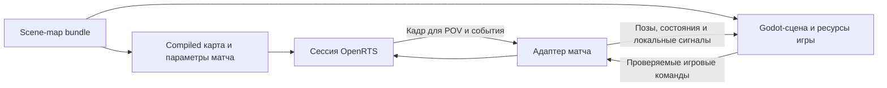

# Этап C. Гибридный runtime OpenRTS и Godot

Цель C — дать игре полноценную Godot-сцену с собственной камерой, тайловыми слоями, окружением и анимациями, связанную с независимым матчем OpenRTS. Первый потребитель — нативный изометрический Canvas. Он опирается на действующие контракты карт, команд и повторов. [Дорожная карта](roadmap.md#этап-c--семантические-контракты-и-богатое-представление) · [Границы симуляции](../simulation-modes/simulation-boundaries.md)

## Первый пилот

- **Изометрическая B5-карта.** `InitialPropertiesMapIsometric` уже проверена на точные позиции, начальное HP, локальный MaxHealth и поворот здания. Её текущий compiled-запуск служит контролем игрового результата. Пилот получает отдельный Canvas-вход в проекте sandbox с теми же ресурсами и каталогами. Конкретная игра выбирает свой профиль и совместимые карты. Сравнение профилей проводится отдельными запусками с одинаковой игровой конфигурацией и одним артефактом B5 в каждом каталоге. [Изометрическая сцена](../../../sandbox/examples/maps/InitialPropertiesMapIsometric.tscn) · [Проверки B5](../../verification/051-map-initial-properties.md)
- **«Скалистый перевал».** Второй образец уже содержит рельеф, рампы и фиксированную расстановку. Он проверит высоту спрайтов, перекрытия и выбор цели на рельефе после подтверждения плоского пути. [Сцена Rocky Pass](../../../sandbox/examples/maps/RockyPass.tscn) · [Высота в Canvas](../simulation-modes/godot-native-2d.md#как-показывать-высоту-в-canvas-2d)
- **Готовые части.** B и P1 дают 2D-извлечение, общий compiler, проверку выбранного матча, остановку, перезапуск и экспорт. Текущий 2D compiled-запуск строит отображение из проекции, а 3D bundle открывает исходную сцену. B6 уже связывает матч и повтор с игровыми данными карты, стартовым набором и правилами. `SandboxSession` даёт доступ к существующим локальной, сетевой и replay-сессиям. [Аудит](authoring-audit.md) · [Загрузчик сцен](../../../sandbox/Sandbox.SceneMaps.cs) · [Контракт B6](../../decisions/052-map-match-replays.md) · [SandboxSession](../../../sandbox/Controls/SandboxSession.cs)

## Приоритеты

| Приоритет | Фича | Проверяемый результат | Этап |
| --- | --- | --- | --- |
| P0 | 2D scene-map bundle и Canvas-запуск | Из редактора публикуются связанная `.tscn` и compiled проекция. Canvas открывает обе части, .NET headless читает проекцию. Ошибки профиля и зависимости диагностируются до начала матча | C1 |
| P0 | Авторская камера, тайлы, ввод и Models | Работают `Camera2D` и `TileMapLayer` карты. Выбор и приказ `Move` сохраняют точные координаты. Пехота, машина с башней и здание показаны по опубликованным позам и семантике Models | C1 |
| P0 | Сценовая привязка и эффекты | У здания есть авторский якорь. Видимое повреждение включает длительный эффект, уничтожение даёт разовый эффект. Состояние можно восстановить по кадру | C2 |
| P0 | Брифинг и передача камеры | Сцена проигрывает короткий эпизод, передаёт камеру игроку после завершения или пропуска и очищает привязки при выходе из карты | C2 |
| P0 | Жизненный цикл, POV, replay и диагностика | Restart, seek в обе стороны, пауза, шаг и смена наблюдателя корректно обновляют вид. Диагностика указывает карту, якорь, поколение, тик и получателя | C3 |
| P0 | Поставка и проверка независимости | Canvas запускается из PCK с выключенным addon. Один журнал сходится в Canvas и .NET replay. Короткий сетевой сценарий B6 проходит на том же игровом fingerprint | C4 |
| P1 | Canvas-рельеф на Rocky Pass | Высота, рампа, выбор цели и порядок перекрытия согласованы с проекцией. Проверяются подъём, спуск и проход за декорацией | C4 |
| P1 | Замеры пакетного представления | Замеры на 1 000 и 10 000 видимых объектов помогают выбрать группировку, изометрическую сортировку и границу между массовым и сценовым видом | C4 |
| P2 | Расширения под следующую игру | Дополнительные Models и эффекты, свой HUD, расширенная инспекция, GDScript-оболочка или второй графический хост получают приоритет при появлении потребителя | После пилота |

## Контракт между матчем и сценой

**Данные и команды.** OpenRTS хранит авторитетные позиции, HP, владельца, действия и игровые результаты. Godot управляет камерой, светом, звуком, частицами и графикой. Для пилотного дыма достаточно видимого HP и порога, выбранного сценой. Пожар с уроном станет отдельным правилом игры. Игрок отправляет `UnitAction` через действующую сессию. Брифинг и смена камеры выполняются локально. Если сценарной вставке нужен игровой результат, он проходит через проверяемый приказ или правило на тике.

**Идентичность.** Сценовый якорь указывает канонический ID размещённого объекта с учётом контекста prefab. Связку ID → EntityId планируется получить при создании объектов той же фабрикой `MapMatch` для локального, сетевого и replay bootstrap. Сейчас фабрика использует метки placements для диагностики. Соответствие действует в пределах поколения мира. Неизвестный или повторный ID диагностируется в исходной сцене. Динамически созданные сущности получают вид по типу и Model. [MapMatch](../../../src/OpenRTS.Content/Maps/MapMatch.cs) · [Авторинг prefab](../../map-authoring.md#нативное-2d-редактирование)

**Кадры и события.** Пакетный renderer заимствует `FrameLease` на один проход. Сценовый обработчик получает небольшую копию нужных полей. Кадр восстанавливает длительные состояния, очередь событий доставляет разовые сигналы при пропущенном кадре. Для игрока оба источника соблюдают его видимость. Seek восстанавливает состояние целевого тика. Эффекты из пройденной истории пропускаются. Новое событие применяется после кадра того же поколения на тике события или позже. [FrameExchange](../../../src/OpenRTS.Gameplay/Hosting/FrameExchange.cs) · [ReplaySession](../../../src/OpenRTS.Network/ReplaySession.cs) · [Текущий сброс представления](../../../sandbox/Controls/Sandbox.Replay.cs)

## Порядок реализации

### C0. Зафиксировать контрольный сценарий

Записать fingerprints B5, отчёт tick-zero и точные позиции. Подготовить короткий детерминированный журнал с движением и боевым событием. Если событию нужна другая расстановка, использовать отдельную тестовую карту и сравнивать представления на одной её версии. **Приёмка.** Контрольный запуск воспроизводится из .NET и действующего sandbox.

### C1. Запустить живую изометрическую сцену

Расширить публикацию bundle на `OpenRtsMap2D`. Профиль пилота задаёт вход игры, а хост проверяет тип корня. `SceneMapBundle` уже связывает путь к сцене с её compiled данными. Если для выбора хоста до загрузки потребуется поле профиля, проверка схемы должна включать действующие v1 bundles. Путь 2D compiled остаётся доступным для быстрой сверки.

Переиспользовать базис `MapProjection2D` по `TileMapLayer.MapToLocal`. Ввод проходит через преобразования viewport и камеры в координаты слоя карты, затем в точный `WorldPosition`. Проверить смещённый корень, zoom и позиции у края клеток. Первый небольшой пакетный renderer проверяет порядки корпуса, башни и одной декорации. **Приёмка.** Build and play запускает сцену и открывает управление юнитами. Tick-zero и хеш контрольного прогона совпадают с C0. [Проекция OpenRTS](../../../sandbox/addons/openrts_editor/MapProjection2D.cs) · [TileMapLayer](https://docs.godotengine.org/en/4.7/classes/class_tilemaplayer.html) · [Canvas transforms](https://docs.godotengine.org/en/4.7/tutorials/2d/2d_transforms.html)

### C2. Подключить сцену к состоянию матча

Добавить один якорь для здания и один локальный брифинг. Проверить включение эффекта у здания, загруженного с повреждением, и одно срабатывание при уничтожении даже при пропуске графического кадра. Брифинг определяет доступность локального ввода и передаёт камеру при завершении или пропуске. Готовность матча и игровое время контролирует сессия. **Приёмка.** Замена эффектов, камеры и длительности брифинга сохраняет отчёт симуляции при одинаковом журнале команд.

### C3. Довести жизненный цикл и восстановление

Согласовать поколение кадра и очередь событий при restart и seek. При смене POV очистить выделение, кэши и эффекты прежнего вида, затем восстановить вид для текущего наблюдателя. Проверить появление, потерю видимости, возвращение и удаление привязанного объекта. Зафиксировать реакцию на смену типа и пребывание в транспорте на существующем примере, если они доступны пилотной сущности. При выходе из матча отсоединить обработчики и освободить сцену и сессию. **Приёмка.** Restart и seek в обе стороны дают вид состояния целевого тика. POV соблюдает границы видимости. Пауза, шаг и пропуск render frame проходят проверку порядка событий.

### C4. Проверить поставку, совместимость и нагрузку

Расширить существующие проверки authoring, экспорта и B6 на 2D bundle. Прогнать запуск из редактора, установленную карту, чистый PCK, один журнал в Canvas и .NET replay, короткий сетевой матч. Сверить игровые fingerprints и хеши на одинаковых тиках. Изменение авторской камеры, света, эффектов или FPS сохраняет идентичность матча при тех же игровых входах. Зависимости сцены продолжают проверяться при поставке. В регрессии включить 3D bundle, 2D compiled и M1 YAML. **Приёмка P0.** Опубликованная карта запускается с выключенным addon, а результаты симуляции совпадают.

Затем проверить рельеф Rocky Pass. XY остаётся опорой и координатой игрового приказа, опубликованная высота задаёт визуальное смещение спрайта. Отдельно проверить выбор курсором при перекрытии и опорный ключ сортировки. Для плотного Canvas сравнить варианты группировки с `MultiMeshInstance2D`. Y-sort штатно работает между CanvasItem, поэтому порядок отдельных экземпляров в одном пакете относительно декораций требует своего решения. **Приёмка P1.** Сценарий проходит при подъёме, спуске и перекрытии. Медиана и p95 времени кадра, стоимость подготовки пакетов, видимые экземпляры и draw calls измеряются отдельно от тиков симуляции. [CanvasItem](https://docs.godotengine.org/en/4.7/classes/class_canvasitem.html) · [MultiMeshInstance2D](https://docs.godotengine.org/en/4.7/classes/class_multimeshinstance2d.html)

## После C

Расширенная компиляция навигации и ИИ, полноценный игровой 3D-террейн, многоопорные и логические слои, генерация и streaming остаются самостоятельными эпиками. Частичный D начинается с конкретного заменяемого игрового расчёта и отдельного контракта для тика, сети и повтора. Модульность Gameplay развивается по своему плану. [Компиляция](../map-compilation/plan.md) · [3D-террейн](../3d-terrain/plan.md) · [Слои](../layered-maps/README.md) · [Генерация](../map-generation/README.md) · [Композиция механик](../mechanic-modularity/composition.md)
