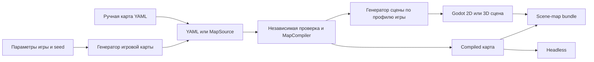

# Генерация игровых карт и Godot-сцен

Исследование от 18 ноября 2026 года. [Пакет по типам симуляции](../simulation-modes/README.md) · [Источники](../simulation-modes/sources.md).

У генерации две разные задачи. **Генератор сцены** строит оформление для уже заданной карты. **Генератор игровой карты** выбирает грунт, препятствия, старты и объекты по параметрам и seed. Первый можно проверить на существующем YAML. Второму нужны правила качества карт конкретной игры, поэтому его имеет смысл проектировать отдельно.

## Как получить 2D или 3D сцену из YAML

M1 уже разворачивает палитру, строки и размещённые кисти. Генератору сцены лучше брать нормализованные данные после общей подготовки. Так правила грунта и приоритета кистей останутся общими, а начало матча будет воспроизводимо. Явные координаты и порядок игровых объектов сохраняются. Если игра поддерживает входные свойства B5, которые текущий M1 не выражает, подходит `MapSource` соответствующей версии. [Формат M1 и кисти](../game-maps/README.md) · [Компиляция и канонизация](../../decisions/047-map-compilation.md) · [Начальные свойства B5](../../decisions/051-map-initial-properties.md).

| Данные входа | Профиль Godot 2D | Профиль Godot 3D |
| --- | --- | --- |
| Грунт и визуальные ID | Тайлы, переходы, варианты, overlay и occluders | Чанки покрытия, материалы, декали и зоны деталей |
| Старт, юнит, здание | 2D маркеры и Models preview в авторском режиме | 3D маркеры и preview в авторском режиме |
| Дорога, берег, лес | Настройки TileSet и шаблоны композиции | Правила подбора материалов, мешей и визуальных prefab |
| Оформление локации | Canvas-свет, слои фона, погода и ролики | Окружение, объёмный свет, частицы, 3D камеры и анимации |
| Игровая поверхность с высотой | Проекция, условные обозначения высот и опор | Меш из проверяемых данных поверхности после расширения независимого формата |

Одинаковый семантический грунт может дать разный вид в разных играх. Например, берег складывается из клеток воды и суши. 2D-профиль соберёт тайловую кромку, а 3D-профиль построит геометрию покрытия и выставит воду. Если камни у берега должны блокировать движение, их форма и расположение становятся явными игровыми входами до компиляции. Для декора допускаются вариации по отдельному seed.

Текущий YAML задаёт плоскую карту. Из него можно сгенерировать визуальный рельеф, но игровое плато, обрыв и рампа должны иметь представление в независимых данных. Для 3D эксперимент с игровыми высотами можно провести на данных `sandbox3d`, а общий формат брать из эпика рельефа. При несовпадении видимой и игровой геометрии появятся ошибки клика, обхода и строительства. Этот риск стоит тестировать даже для декоративного рельефа. [Срез `sandbox3d`](../3d-terrain/plan.md#план-sandbox3d) · [Контракты рельефа](../3d-terrain/contracts.md).

## Кому принадлежит исходник

| Режим | Правило редактирования |
| --- | --- |
| YAML как исходник | Храним YAML и профиль генерации. Сгенерированную ветку сцены можно заменить при пересборке. Ручные украшения, камера и сценарии лежат отдельной сценой или отдельной явно авторской веткой |
| Сцена как исходник | Импортируем результат как стартовый шаблон. Дальше автор редактирует сцену, а B извлекает из неё игровые данные. При смене YAML требуется явный повторный импорт |
| Проекция без ручной сцены | Для быстрой генерации в матче можно построить карту на хосте из готового артефакта. Качество экспорта и цена запуска проверяются отдельно |

По умолчанию удобен редакторский или пакетный генератор с сохранением `PackedScene`. Упаковка должна назначить владение нужным узлам, проверить зависимости, сохранить и повторно открыть сцену, затем пройти существующий bundle workflow. После сохранения следует сравнить извлечённую карту с нормализованным входом. При чистой проекции сохраняются ID, порядок объектов, позиции, старты, свойства и gameplay fingerprint. Файл сцены и её ресурсы могут отличаться между профилями и версиями. Локальные декоративные варианты не входят в расчёт игрового грунта. [PackedScene](../simulation-modes/sources.md#s008) · [Scene-map bundle](../../decisions/050-godot-scene-map-bundle.md).

## Генерация случайной игровой карты

Практический первый сценарий — двухместный skirmish с повторяемым режимом. На входе размеры, допустимые профили стартовых наборов, тема, количество ресурсов или соответствующих объектов и seed. Если для режима важна симметрия, задаётся её конкретное преобразование. Изменяемое число коридоров и разные зоны расширения дают вариативность. Генератор кладёт в YAML или `MapSource` семантический грунт, старты и упорядоченные размещения. Компилятор подтверждает структуру, а подготовка матча и дополнительные проверки оценивают результат.

| Подход | Польза и ограничения |
| --- | --- |
| Шаблоны и симметричные преобразования | Самый ограниченный и проверяемый старт. Проще гарантировать свободные площадки и положенный размер прохода. Варианты могут ощущаться слишком похожими |
| Конструктивная генерация с проверкой и ограниченными повторами | Даёт больше разнообразия. Удобно сначала выбирать зоны, пути и старты, затем достраивать terrain и размещения. При узких ограничениях частые отказы поднимают стоимость |
| Поиск кандидатов и оценка ботами | Позволяет сравнивать карты по игровым метрикам. Стоимость и качество зависят от бота и сценария. Уместно как офлайн-анализ после простого генератора |

В OpenRA `ClassicMapGenerator` показывает, как editor world принимает seed, число игроков, параметры симметрии и грунта. Он использует отдельные генераторы случайности для игроков, топологии, декора и ряда других шагов. Это референс разделения задач и параметров. Конструктивные методы и автоматическая оценка рассматриваются шире в литературе по PCG. [Источники по OpenRA и PCG](../simulation-modes/sources.md#s011).

### Что считать годной картой

- Компиляция и выбранные стартовые наборы проходят реальный `Prepare` и создание мира. Точки старта и начальные строения удовлетворяют body/footprint, bounds и `CanStop`. B0–B1 разделяет статическую проверку и физическую расстановку. [Контракт компиляции](../../decisions/047-map-compilation.md).
- По игровому навигатору и нужным профилям каждый старт имеет заявленные пути. Проверяются ширина узких мест, доступ к ресурсам, место под стройку и варианты расширения. Простая связность клеток переоценивает доступность для большого тела. Для асимметричных карт сравнивать время доступа, защищённость и варианты выхода. Симметрия по клеткам сама по себе не проверяет условия боя.
- Повтор с теми же seed, версией алгоритма, профилем и контентом воспроизводит тот же канонический вход. Зафиксировать порядок обходов и сравнения равных оценок. Вариативность оформления имеет собственный поток случайности. Для матчей и replay предпочтительно сохранять готовый артефакт и точный digest. Вариант с передачей seed потребует одинакового генератора у всех участников и проверки результата перед стартом. [План B6 и Network](../godot-integration/network-reuse.md).
- На большой серии seed замерить долю отказов, время генерации, разброс метрик доступности и повторяемость. Ограничить время и число попыток, сохранять причину отказа и seed для воспроизведения. Несколько ручных playtest и простая проверка ботами выявят дефекты, которые не видны по метрикам.

## Этапы исследования

1. Взять одну M1 карту с дорогой, берегом, стартами и постройкой. Сгенерировать авторскую Godot-сцену, переоткрыть, собрать bundle и подтвердить ту же игру через headless. Проверить повторную генерацию после смены визуального профиля.
2. Когда оба вида станут реальными потребителями, собрать ту же карту в двух профилях. Измерить ручные правки, время загрузки, объём ресурсов и стабильность переиздания. Выбирать между авторской сценой и проекцией в рантайме на основании конкретного workflow.
3. Для случайного skirmish проверить сначала ограниченный генератор с симметрией и валидатором. Дополнять языком конфигурации, офлайн-оценкой, рельефом или слоями по потребности игры. Для слоёв генератору понадобится проверять доступность порталов и альтернативных маршрутов. [Слои карты](../layered-maps/README.md).

Смена каталога грунта, локомоторов или правил размещения может сделать прежний seed непригодным. Этот риск закрывается совместимым артефактом и проверкой на уровне матча. Открытый вопрос для случайных карт — какой баланс разнообразия, скорости генерации и измеримой честности нужен конкретному режиму.
