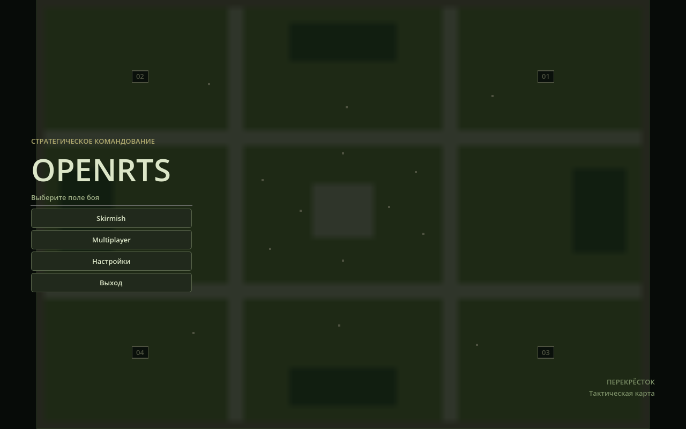
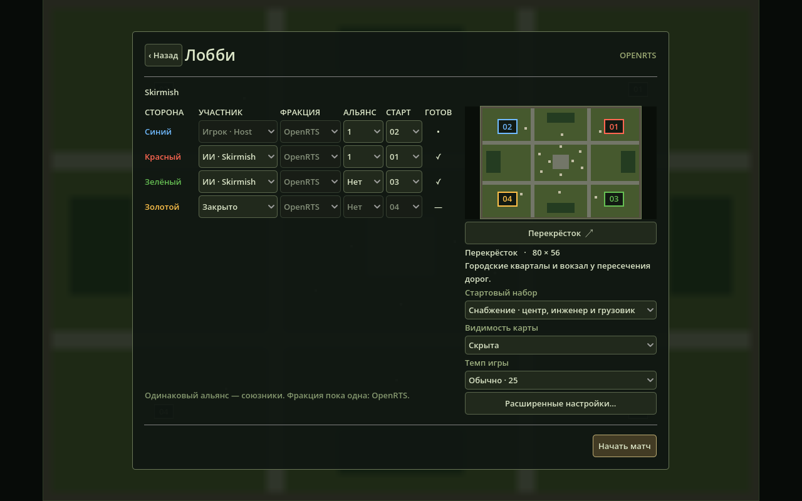
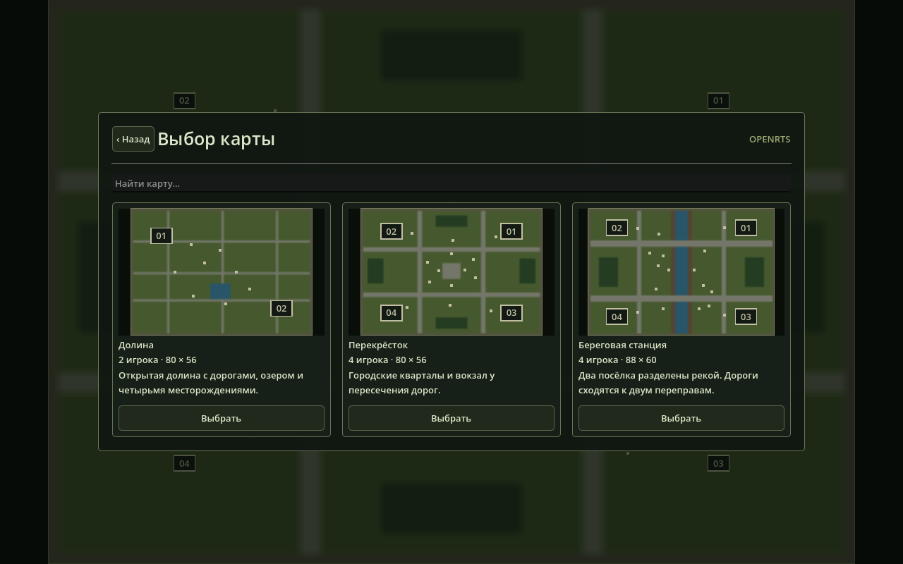
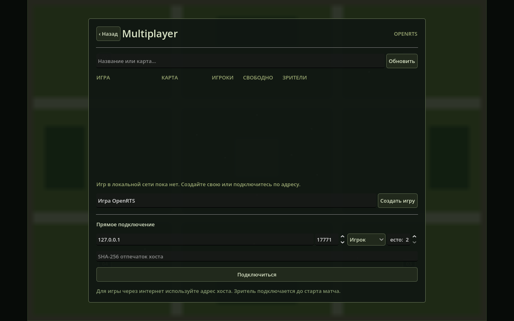

# 041. Проверка меню и синхронизированного лобби

**Дата:** 17 ноября 2026. [Контракт041](../decisions/041-game-shell-and-lobby.md). Реализация на native Godot/C#, без браузера и сторонних UI-зависимостей.

## Результаты

- `./tools/dev.sh test --filter=Lobby`: сборка без warnings/errors, **33сетевые**, **20DeclarativeContent**, **2целевые Gameplay** проверки — пройдены. Это целевой запуск Gameplay; весь набор симуляции не объявляется пройденным.
- Новые сетевые сценарии: host recipe заменяет отличающиеся defaults гостя, изменение настроек сбрасывает Ready и требует hash ACK; гость не может Configure, зритель не может Submit/Ready/Pause;2human+AI+closed+зритель завершают матч с одинаковыми результатами/байтами журналов и replay. UDP-каталог обнаруживает реальное объявление и список свободных слотов на loopback. Отдельно проверено, что потеря зрителя не приостанавливает игроков. Прежние NET1/NET2/WAN,8human и фиксированные deadlines сохранены.
- Gameplay: союзники не стреляют друг в друга; FFA хеши прежние; союзную постройку нельзя захватить, нейтральную — можно.
- `--filter=AI2`: **9прежних AI2** проверок пройдены после изменения выбора противников. Отдельная проверка NET3 takeover с ненулевого тика также была пройдена в040.
- `Godot --headless -- --verify-match-setup`: прежний сценарий карт, вместимости, режима, перестановки стартов и запуска сцены пройден.
- `verify-network --net3 --spectator`: **4независимых процесса** (3human, AI4, зритель). У гостей до соединения выбрана другая карта; она автоматически заменяется картой хоста. Пройдены Ready/Start, ownership, production, локальное меню, согласованная пауза/Resume/Stop и4replay. Финальный hash одного прогона: `2DCFCBBD507FC66F65A86B67E7FF0AA9F6097872E81EA9C8787D363BE6FB0F7A` у всех процессов. Момент UI Submit меняет hash между прогонами; проверяется согласие внутри прогона.
- `Godot -- --verify-menu`: главное меню, Skirmish, каталог карт, переключение карты, обмен стартов, альянсы, несколько ИИ/закрытые места, advanced/settings, браузер Multiplayer, возвраты и запуск правильной сцены пройдены в настоящем окне1280×800. Скриншоты визуально проверены. Расширенное меню матча имеет прокрутку.

Raw logs и изображения: [041-menu](041-menu/). Для повторения:

```sh
./tools/dev.sh verify-menu
./tools/dev.sh verify-menu --visible --menu-captures=/tmp/openrts-menu
./tools/dev.sh verify-network --net3 --spectator --output=/tmp/openrts-lobby
```

## Экраны

Главное меню:



Лобби Skirmish:



Каталог карт:



Multiplayer и прямое подключение:



Параметры и личные настройки: [advanced](041-menu/advanced.png), [settings](041-menu/settings.png).

## Ограничения

Каталог показывает LAN-объявления; интернет-сервиса поиска/NAT traversal нет. Наблюдение начинается до Start и раскрывает полный мир. Mid-game join/rejoin/snapshots и host migration отсутствуют. Альянсы фиксированы при создании и не дают общего управления/обзора/экономики. Фон пока статический; партия двух ИИ для главного меню отложена. Полные прогоны Gameplay/Godot verify, физический LAN и масштабы10000в этой работе не измерялись. Проверки не подтверждают защиту от MapHacks в полном клиентском lockstep.
