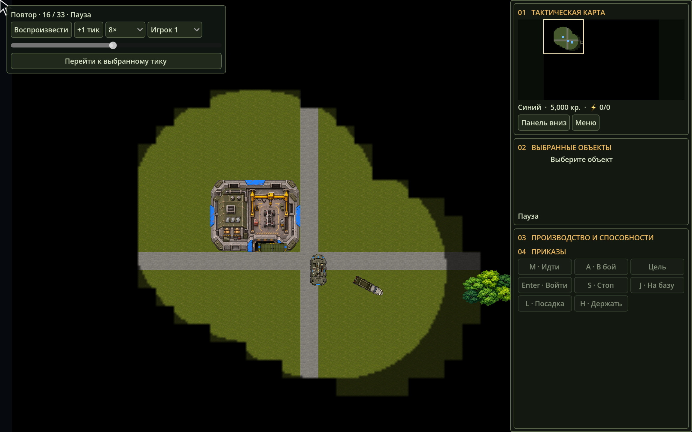

# 042. NET4.1 — replay recovery и проигрыватель

**Дата:** 17 ноября 2026. [Контракт042](../decisions/042-net4-replay-recovery.md), [следующие части NET4](../research/networking/net4.md).

## Проверки

`./tools/dev.sh test --filter=session`: сборка без предупреждений/ошибок, **40Network**, **20DeclarativeContent**, **6session/lifecycle** проверок пройдены. Gameplay запускается с фильтром, полный набор симуляции не объявляется пройденным. Семь новых NET4 checks включены в обычный сетевой набор; отдельно: `dotnet run --project tests/OpenRTS.Network.Tests -- --net4`.

Матрица восстановления: production100тиков, aviation420тиков, sensors/fog48тиков на существующих сценариях sandbox. Для каждого пишется журнал; capture на0, K и T, restore с другой worker-конфигурацией там, где фабрика её поддерживает, затем сравнение **каждого** последующего World hash с непрерывным запуском. K=12/185/12. Используются разрешённые сетевые intents; административные Destroy/PlayAnimation из диагностического сценария не записываются. Последующие команды берутся из записи; ИИ заново не планирует.

| Сценарий | K | Размер checkpoint | Restore, мс |
| --- | ---: | ---: | ---: |
| Production | 12 | 2936 B | 98.84 |
| Aviation | 185 | 33512 B | 59.47 |
| Sensors/fog | 12 | 2555 B | 2.67 |

Это один прогон на локальном macOS/Arm64, .NET10, после создания исходного журнала; время включает разбор/проверку payload, фабрику и replay. Оно не является percentile, сравнением runtime snapshot или оценкой больших матчей. Полные исходные замеры0/K/T находятся в [suite.log](042-net4/suite.log).

Проверены: отдельный процесс восстановления checkpoint; обрезанный/изменённый payload и trailing bytes; byte/tick quota; другой мир; отмена; превышение catch-up budget; явное чтение legacy v2 с descriptor/factory; изменённый hash тика5 даёт DesyncException.Tick=5; пауза, один шаг, seek вперёд/назад,8× playback, финал и seek назад после финала.

## Настоящий Godot

`./tools/dev.sh verify-replay --visible --output=/tmp/openrts-replay` сначала записывает завершённый TLS-матч двумя независимыми Godot процессами, затем третий процесс находит его в реальном меню «Повторы». У Host `--fog-hold=7`, у гостя и проигрывателя значение по умолчанию: параметры правильно передаются и восстанавливаются из recipe.

Проверяются tick0 на паузе, запрет Submit/RTS ownership, кнопка +1, seek вперёд и назад, player POV через FrameExchange filtering, скорость8×, пауза на полностью проверенном конце и повторный seek. Пройдён оконный тест, изображение проверено. Точный hash конкретного прогона меняется с моментом живого UI Submit; каждый replay сравнивается со своим источником.

Артефакты: [native replay log](042-net4/replay.log), [запись источника](042-net4/record.log), [NET4 checks](042-net4/net4-checks.log), [итоговая сборка](042-net4/build.log).

## Что не доказано

Это сохранение истории с восстановлением O(K). Canonical runtime snapshot/restore, возврат живого сетевого участника, tokens/epochs и перенос состояния ИИ отсутствуют. Полная матрица редких burst/windup/payment/boarding/knowledge состояний для runtime snapshot остаётся NET4.2; данный тест сравнивает будущие hashes выбранных сценариев, а не доказывает полноту будущих бинарных схем. Physical LAN, сетевой перенос checkpoint и нагрузки10000не измерялись. Protected mode и его filtered bootstrap не реализуются этим срезом.
