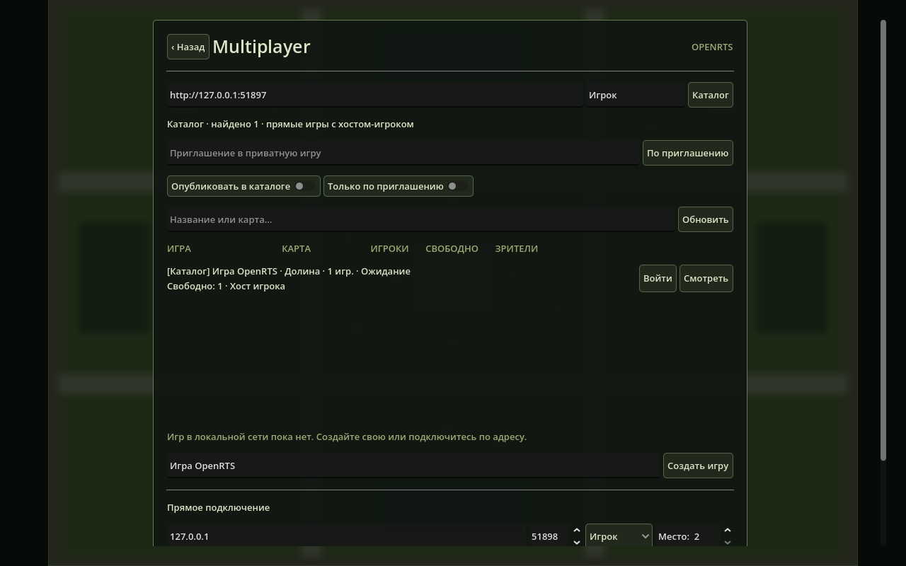

# 044. NET5 — каталог матчей и допуск

**Дата:** 17 ноября 2026. [Контракт044](../decisions/044-net5-match-directory-admission.md), [план](../research/networking/net5.md).

## Исполняемые проверки

`./tools/dev.sh test --filter=session` — **63Network**, **20DeclarativeContent**, **6session/lifecycle**; сборка без предупреждений/ошибок. Полный Gameplay набор фильтром не запускается; известные baseline failures из [037](037-net1.md) этим срезом не менялись. Все прежние NET1–NET4 проверки входят в сетевой прогон.

Семь новых NET5 сценариев:

1. Key-bound login: чужой ключ и повтор challenge отвергаются. Проверены session expiry, чужая lease, TTL/закрытие регистрации; ToString не раскрывает bearer/lease.
2. Конкурентные Join последнего места дают один grant; повтор request ID возвращает тот же ticket. Cancel прекращает запрос и карантинит место до expiry. Проверены private invite, скрытие из общего списка, несовместимые rules/content и устаревший heartbeat.
3. Confirm идемпотентен, не меняет исходную host revision. Pending confirmed места учитываются до новой публикации; предел8spectators сохраняется, даже если receipts приходят раньше heartbeat.
4. Host gate проверяет подпись, account key proof/fresh challenge, роль/slot, другой Match, expiry и однократность nonce. Изменённый ticket и чужая подпись отвергаются.
5. Отдельный HTTP процесс, pinned TLS host/client и настоящий TCP byte relay: direct endpoint намеренно недоступен, fallback достигает того же host pin. Вход без билета отвергается; с билетом — согласуется. Реальный `DirectoryListing` обновляет heartbeat/Confirm. Сервис выключается, publisher сообщает ошибку, а peers продолжают тики и завершаются с одним hash, побайтно одинаковыми журналами и offline replay. Ticket в journal отсутствует.
6. Restart HTTP сервиса с сохранённым signing key удаляет старую session; клиент заново доказывает тот же account key и регистрирует новый матч. Durable catalogue/reservations этим не обещаются.
7. HTTP body malformed/oversized и request-rate limit возвращают bounded ошибки400/413/429.

Временные границы session/challenge/reservation проверяются управляемым TimeProvider без ожидания часа. HTTP service/TLS/fallback проверяются отдельными настоящими процессами/соединениями, не mock transport. Byte relay — существующий стенд пересылки TCP; физический NAT/публичный провайдер не развёртывался.

## Godot UI

`./tools/dev.sh verify-directory --visible --output=/tmp/openrts-net5-final` — отдельный HTTP service и два оконных Godot процесса. Host использует реальную кнопку создания с включённой публикацией, guest — «Каталог» и каталожную кнопку «Войти». Ключевые сессии/ticket/proof создаются штатными API, роли назначаются grant. Далее проходят обычные Ready/Start, ownership, production, локальное меню, Stop, одинаковый hash и проверка replay обоими процессами.

Снимок браузера проверен визуально: каталожная запись отображается без ошибочного LAN-дубликата, видны карта/фаза/роль; поле invite имеет доступную ширину. Опубликованные/private игры не объявляются обычным LAN-режимом; ticketless direct обход закрыт host policy. Отдельный ручной прогон приватного приглашения между двумя окнами не выполнялся; private resolve/join и privacy проверены API-тестами.

Артефакты: [полный прогон](044-net5/checks.log), [Godot driver](044-net5/godot.log), [HTTP service](044-net5/directory.log), [host](044-net5/host.log), [guest](044-net5/guest.log), [финальная сборка](044-net5/build.log). Private signing key из временного стенда не копируется в репозиторий.

## Что не доказано

Нет публичного HTTPS deployment, физического WAN/NAT, автоматического port mapping/reverse tunnel или испытания массовой нагрузки. Account key живёт в памяти Godot; внешние login providers/перенос постоянной identity не реализованы. Registry в памяти; restart не сохраняет reservations и их идемпотентность. Host всё равно не принимает двух live peers одного slot. Защищённая симуляция/достоверный рейтинг и серверная аналитика остаются отдельными этапами.
