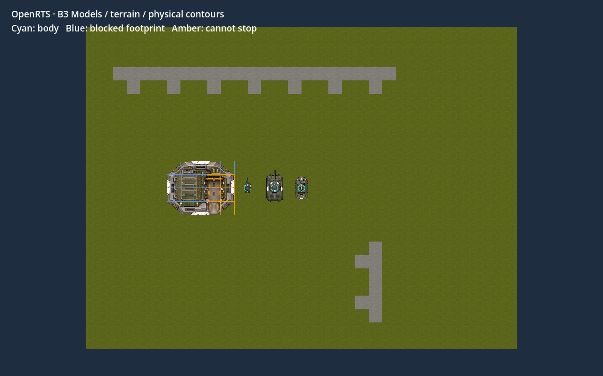

# 049. Проверки B3: terrain, Models и физические контуры

**Дата:** 18 ноября 2026. Основа `a12d753e9462c00b059f55c8c01945897e8742a5` и изменения B3, macOS arm64, .NET 10.0.105, Godot 4.7.2 .NET. [Решение/инструкция](../decisions/049-godot-terrain-models-preview.md), [машинные результаты](049-godot-terrain-models-preview/results.json), [краткий вывод](049-godot-terrain-models-preview/checks.txt).

## Итог

- `./tools/dev.sh verify-authoring`: Debug solution **0 warnings / 0 errors**, scene extraction **43 checks**, editor **51 checks**, все процессы code 0. Использовались локальный NuGet feed/`NuGetAudit=false` и разрешение локального IDE socket для Godot .NET editor.
- Регрессии Maps: **14/14** на текущих binaries; исходные M1 traces и compiled-map tests сохранились.
- `ExportRelease` build Sandbox: **0 warnings / 0 errors**. Полный экспорт игры этим не проверяется.
- Существующий `--verify-presentation`: **PASS**, включая alpha, directional/infantry walking, independent weapons/effects и 10000-pose buffers. Это регрессия runtime renderer, а не editor benchmark.
- GPU capture preview на Apple M3 Max / OpenGL Compatibility: code 0, **6 активных sprite parts**, **87 выделенных frame batches**, 1280×800. Число frame batches не называется числом активных draw calls.

Общий Gameplay/Network набор целиком не повторялся. Восемь ранее известных сбоев из [047](047-map-compilation.md) этим отчётом не объявляются исправленными.

## Новые проверки

[MapTerrainChecks](../../sandbox/Verification/MapTerrainChecks.cs) проверяет отдельные слои, sparse/rotated brush, retain пустых полей, порядок перекрытия, восстановление base при снятии strokes, malformed arrays, duplicate StrokeId, выход за bounds и unknown terrain. Рисование между редкими mouse samples не оставляет дыр. PackedScene сохраняет Resource strokes; исходный preset не сохраняется как изменяемый массив кисти. [Новый sample](../../sandbox/examples/maps/TerrainAuthoringMap.tscn) загружается и компилируется с четырьмя authored objects, двумя starts и shaped brushes.

[MapTerrainEditorChecks](../../sandbox/addons/openrts_editor/Tests/MapTerrainEditorChecks.cs) вместе с B2 checks проверяет:

1. Настоящий SpriteWorldView показывает три типа; internal preview не меняет MapSource и не попадает в PackedScene.
2. Один drag становится одним stroke/action; undo и redo восстанавливают всю карту и те же значения. Cancel/остановка paint не меняют source, последующая правка palette не переписывает нанесённые клетки.
3. `_Forward3DGuiInput` с настоящей Camera3D проецирует pointer в нужную клетку, поглощает paint, пропускает Alt для camera navigation; Escape отменяет pending stroke.
4. Texture binding перестраивает только вид terrain, сохраняя gameplay fingerprint. Circle/box имеют физические extents; sparse footprint сохраняет holes и смещения.
5. Semantic ID выбирает правильный marker в prefab; ошибка compiler выбирает её источник. Неизвестные типы и неправильная геометрия сохраняют понятный field/scene locator.
6. Editor compile сохраняет terrain/visual клеток мазка. Вода под rifleman и пересекающиеся bodies отвергаются прежними placement rules, хороший artifact остаётся прежним. Undo возвращает допустимую карту.
7. Candidate starts не создаются как активные players при проверке authored objects; отдельный input со 100 starts проверяется без назначения 100 игроков.
8. Неудачный loader SpriteFrames освобождает native renderer node; scene switch/disable/cancel/stale-result и повторное включение addon продолжают проходить B2 проверки.

## Визуальная проверка

Снята отдельная GPU-сцена [MapPreviewCapture](../../sandbox/Verification/MapPreviewCapture.cs) с теми же MapEditorPreview/SpriteWorldView/TerrainView и `MapPreviewGeometry`, которые использует addon. Изображение осмотрено: видны две области shaped road, Models пехоты/танка/инженера и завода, cyan bodies и клетки заводского footprint с отдельной зоной no-stop. Source gameplay fingerprint после построения preview остаётся тем же.



Воспроизведение после build/import:

```sh
../Godot_mono.app/Contents/MacOS/Godot --path sandbox res://Verification/MapPreviewCapture.tscn --rendering-method gl_compatibility -- --preview-capture=/tmp/openrts-b3-preview.png
```

Это GPU smoke изображения используемых batches/контуров. Он не подменяет ручной проход по всем native editor widgets, кликам/drag на рабочем столе, размерам dock и DPI. Автоматические input/undo/serialization tests проходят в настоящем headless EditorPlugin.

## Независимый игровой вход

Полученный `artifacts/maps/terrain-sample.ortmap.json` запускался 32 тика с infantry starting set:

```sh
./tools/dev.sh headless --map=artifacts/maps/terrain-sample.ortmap.json --start-set=content/start-sets/infantry.yaml --ticks=32
../Godot_mono.app/Contents/MacOS/Godot --headless --path sandbox -- --verify-simulation --map=res://artifacts/maps/terrain-sample.ortmap.json --start-set=content/start-sets/infantry.yaml --ticks=32
```

Оба хоста: code 0, tick **32**, entities **10**, hash `B69CFE2AE0DAAF9D15D31FC199600EC1A653842481A69B7177C5A56383B24BF9`. Godot использует текущую Sandbox scene с независимой проекцией; нового entry loader здесь нет.

## Зафиксированные побочные эффекты и ограничения

Сначала SaveSceneAs переписывал legacy SpriteFrames, загруженные preview. Loader теперь использует Ignore cache для этих ресурсов; итоговый diff `sandbox/resources` пуст. GPU-показ также запускал Godot detect-3D migration текстур. Для **57** существующих PNG import configs сохранён прежний lossless mode и изменён только `detect_3d/compress_to: 1→0`. После итоговых import/editor/GPU runs проверено, что других изменений этих файлов нет; исходные PNG не менялись.

В editor logs ожидаемо видны отрицательные проверки `Unknown unit 'missing'` и stopping terrain под rifleman, а также прежняя ошибка dummy renderer при thumbnail в SaveSceneAs. Ограниченный macOS headless runtime выдаёт прежнее `get_system_ca_certificates`. Все соответствующие проверки и процессы завершились успешно; эти сообщения сохранены в кратком выводе.

Нет обещания интерактивной скорости на максимальных quotas: большие terrain/число strokes требуют B7 измерений. Preview статический, не показывает стартовые армии и не проверяет все варианты стартовых наборов. Brushes редакторские `.tres`; импорта произвольного mesh/TileMap и нового YAML brush frontend нет. Scene-map bundle/entry loader, F6/export и полный runtime package остаются B4; игровой 3D и navigation/AI bake — отдельными будущими эпиками.
